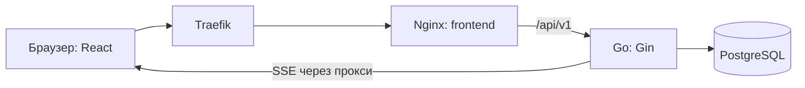

# Кладовая: технический гайд для защиты

Карта кода проекта `umirHack-flagman` на основе `8fc455d` (F31), с учётом последующего упрощения запуска до двух самостоятельных Compose-файлов. Учтены исправления UI, production-приёмка и обновлённый CI. Здесь «реализовано» означает наличие соответствующих маршрутов, модулей и логики в репозитории. Этот документ не подтверждает результаты запуска или нагрузочных испытаний. Основной README содержит краткий запуск; детали реализации приведены здесь.

Порядок индивидуальной предзащиты по ТЗ и сообщению Алексея, а также воспроизводимый числовой сценарий находятся в разделе 22.

## 1. Рассказ о проекте за 30 секунд

«Кладовая — веб-приложение для ресторанного склада. Мы учитываем продукты отдельными партиями со своими сроками годности. При заказе проверяем потребность всей корзины и атомарно списываем ингредиенты, начиная с партий, которые испортятся раньше. По годным остаткам рассчитываем стоп-лист, закупки и рекомендации по продаже. Есть роли сотрудников, журнал действий, аналитика, прогноз дефицита и обновления интерфейса через события».

**Атомарно** означает: весь заказ и его списания сохраняются вместе; при технической ошибке изменения откатываются. При бизнес-отказе сохраняется отдельная попытка заказа, но продукты не списываются.

## 2. Общая архитектура

Backend — модульный монолит: один Go-процесс, внутри которого бизнес-функции разделены на пакеты. React работает в браузере, PostgreSQL хранит данные. В production собранный frontend раздаётся через Nginx; Traefik маршрутизирует внешний трафик. Есть локальная и VPS-конфигурации.



Это основной путь запросов интерфейса. Локальная конфигурация также публикует backend на `api.flagman.localhost`.

| Файл / каталог | За что отвечает |
|---|---|
| [Taskfile.yaml](Taskfile.yaml) | Четыре команды: запуск, остановка, логи и наполнение демоданными |
| [backend/go.mod](backend/go.mod) | Версия Go и зависимости backend |
| [frontend/package.json](frontend/package.json) | Зависимости и npm-команды frontend |
| [backend/cmd/api/main.go](backend/cmd/api/main.go) | Создаёт подключения, сервисы и обработчики; регистрирует маршруты; запускает HTTP-сервер и фоновые задачи |
| [backend/cmd/seed-users/main.go](backend/cmd/seed-users/main.go) | Создаёт демопользователей; с флагом -data также заполняет каталог, настройки и партии через встроенные SQL |
| [backend/cmd/demo-events/main.go](backend/cmd/demo-events/main.go) | Генератор поставок и заказов для выделенного demo-окружения |
| [backend/docs/openapi.yaml](backend/docs/openapi.yaml) | Контракт REST API: пути, поля, ответы, ошибки |
| [frontend/src/main.tsx](frontend/src/main.tsx) | Точка входа интерфейса, CSS и условный запуск MSW в development |
| [infrastructure/manage.sh](infrastructure/manage.sh) | Выполняет запуск и служебные команды с учётом режима local/VPS |
| [.github/workflows/backend-ci.yaml](.github/workflows/backend-ci.yaml) | Проверки backend в GitHub Actions |
| [.github/workflows/frontend-ci.yaml](.github/workflows/frontend-ci.yaml) | Проверки frontend, MSW-приёмка и отдельная production-приёмка с реальными сервисами |

## 3. Как читать backend

Обычный путь запроса: `router → middleware → handler → service → repository → PostgreSQL`.

| Слой | Что делает | Пример |
|---|---|---|
| `handler` | Читает HTTP-параметры, заголовки и JSON; вызывает сервис; возвращает HTTP-ответ | [handler/order/create.go](backend/internal/handler/order/create.go) |
| `service` | Проверяет бизнес-правила и управляет операцией | [service/order/create.go](backend/internal/service/order/create.go) |
| `repository` | Исполняет SQL, читает строки, меняет остатки, берёт блокировки | [repository/order/create.go](backend/internal/repository/order/create.go) |
| `model` | Внутренние структуры предметной области | [model/order.go](backend/internal/model/order.go) |
| `dto` | Структуры входных и выходных данных API с JSON-полями | [dto/order.go](backend/internal/dto/order.go) |

**DTO — Data Transfer Object**: форма данных на границе API. Отделение DTO от внутренних моделей позволяет контролировать, какие поля публикуются клиенту.

| Общий модуль | Назначение |
|---|---|
| [handler/router.go](backend/internal/handler/router.go) | Связывает HTTP-методы и URL с обработчиками; фактическое подключение групп находится в `cmd/api/main.go` |
| [handler/middleware.go](backend/internal/handler/middleware.go) | Request ID, логирование, восстановление после panic, ограничение тела запроса и частоты запросов |
| [config/config.go](backend/internal/config/config.go) | Чтение конфигурации и переменных окружения |
| [database/postgres.go](backend/database/postgres.go) | Пул соединений `pgxpool` и проверка подключения |
| [repository/transaction.go](backend/internal/repository/transaction.go) | `WithinTx`: начать транзакцию, выполнить операцию, commit или rollback; `RequireTransaction` защищает операции, которым нужна явная транзакция |
| [validations/](backend/internal/validations/) | UUID, даты, количества, query-параметры, пагинация, допустимые значения сортировки |
| [errors/response.go](backend/internal/errors/response.go) | Преобразование ошибок в единый код HTTP и JSON-ответ |
| [requestctx/](backend/internal/requestctx/) | Пользователь и идентификатор запроса в `context.Context` |
| [quantity/decimal.go](backend/internal/quantity/decimal.go) | Точные количества в тысячных единицах на `big.Int` |
| [fefo/plan.go](backend/internal/fefo/plan.go) | Чистый алгоритм распределения расхода по партиям |
| [logger/logger.go](backend/logger/logger.go) | Настройка структурированного логирования Zap |
| [telemetry/metrics.go](backend/internal/telemetry/metrics.go) | HTTP-метрики, отказы, конфликты транзакций, работа фоновых задач |

В Go объявления `type X interface` описывают набор нужных методов. Сервисы получают зависимости через конструкторы `NewService(...)`; `main.go` связывает реализации. Это упрощает изолированные проверки и не заставляет бизнес-логику знать устройство HTTP-сервера.

## 4. Карта бизнес-модулей backend

Названия ниже — каталоги внутри `backend/internal/service/`. HTTP-обработчики и SQL обычно находятся в одноимённых каталогах `handler/` и `repository/`.

| Модуль | Что делает | Основные файлы |
|---|---|---|
| `auth` | Вход, серверные сессии, проверка ролей и CSRF | [service.go](backend/internal/service/auth/service.go), [password.go](backend/internal/service/auth/password.go), [policy.go](backend/internal/service/auth/policy.go) |
| `user` | Пользователи, пароли, ревизии, защита последнего администратора | [mutations.go](backend/internal/service/user/mutations.go) |
| `catalog` | Создание и изменение продуктов и категорий, ограничения единиц и активности | [mutations.go](backend/internal/service/catalog/mutations.go), [validation.go](backend/internal/service/catalog/validation.go) |
| `product` | Чтение списка продуктов | [service.go](backend/internal/service/product/service.go) |
| `inventory` | Агрегированные остатки продуктов и фильтры | [service.go](backend/internal/service/inventory/service.go) |
| `batch` | Партии продукта и их вычисляемые статусы | [service.go](backend/internal/service/batch/service.go), [state.go](backend/internal/service/batch/state.go) |
| `supply` | Приёмка поставки и партий, история, детали, сроки, идемпотентность | [create.go](backend/internal/service/supply/create.go), [input.go](backend/internal/service/supply/input.go), [expiry.go](backend/internal/service/supply/expiry.go), [idempotency.go](backend/internal/service/supply/idempotency.go) |
| `dish` | Создание и изменение блюд, версионирование рецептур, предварительный расчёт | [service.go](backend/internal/service/dish/service.go), [update.go](backend/internal/service/dish/update.go), [preview.go](backend/internal/service/dish/preview.go) |
| `menu` | Чтение блюд, доступные порции и стоп-лист | [availability.go](backend/internal/service/menu/availability.go), [service.go](backend/internal/service/menu/service.go) |
| `order` | Проверка корзины, создание и отказ, история и детали | [check.go](backend/internal/service/order/check.go), [stock.go](backend/internal/service/order/stock.go), [create.go](backend/internal/service/order/create.go), [refusal.go](backend/internal/service/order/refusal.go) |
| `procurement` | Сколько закупать до целевого запаса | [service.go](backend/internal/service/procurement/service.go) |
| `hotoffers` | Блюда для приоритетной продажи с объяснениями | [simulation.go](backend/internal/service/hotoffers/simulation.go), [scoring.go](backend/internal/service/hotoffers/scoring.go), [response.go](backend/internal/service/hotoffers/response.go) |
| `dashboard` | Обзор состояния склада | [service.go](backend/internal/service/dashboard/service.go) |
| `writeoff` | Ручное списание партии и история складских движений | [service.go](backend/internal/service/writeoff/service.go), [history.go](backend/internal/service/writeoff/history.go) |
| `expiration` | Фоновое автоматическое списание просрочки | [worker.go](backend/internal/service/expiration/worker.go), [service.go](backend/internal/service/expiration/service.go) |
| `analytics` | Отчёты о списаниях и нехватке ингредиентов при отказах | [service.go](backend/internal/service/analytics/service.go) |
| `forecast` | Прогноз попадания блюд в стоп-лист | [rates.go](backend/internal/service/forecast/rates.go), [simulation.go](backend/internal/service/forecast/simulation.go), [forecast.go](backend/internal/service/forecast/forecast.go) |
| `settings` | Название ресторана, часовой пояс, порог истечения, автосписание | [service.go](backend/internal/service/settings/service.go) |
| `auditlog` | Чтение журнала действий | [service.go](backend/internal/service/auditlog/service.go) |
| `idempotency` | Защита повторной отправки поставок, заказов и ручных списаний | [service.go](backend/internal/service/idempotency/service.go), [cleanup.go](backend/internal/service/idempotency/cleanup.go) |
| `events` | Публикация outbox, чтение событий, фильтрация по ролям | [service.go](backend/internal/service/events/service.go), [filter.go](backend/internal/service/events/filter.go) |

Файлы `service/service.go`, `handler/handler.go`, `repository/repository.go` содержат общий каркас и зависимости. Саму предметную логику нужно искать в подкаталогах соответствующих модулей.

## 5. Как читать frontend

Используется Feature-Sliced Design, FSD. Основные зависимости направлены вниз: `app → pages → widgets → features → entities → shared`.

| Каталог | Простое объяснение |
|---|---|
| [app/](frontend/src/app/) | Собирает приложение: провайдеры, роутер, Redux store, сессия, SSE |
| [pages/](frontend/src/pages/) | Страницы по адресам приложения |
| [widgets/](frontend/src/widgets/) | Крупные блоки: оболочка, редакторы, приёмка, компоновщик заказа |
| [features/](frontend/src/features/) | Действия пользователя: войти, принять поставку, собрать заказ, списать партию |
| [entities/](frontend/src/entities/) | Предметные сущности, их контракты, поиск и API: продукт, партия, заказ, пользователь |
| [shared/](frontend/src/shared/) | Общие контролы, транспорт API, утилиты количества и времени, стили и ресурсы |

Типичные части одного модуля: `ui/` — React-компоненты; `model/` — состояние, схемы, расчёты; `api/` — запросы; `index.ts` — публичные экспорты.

| Файл | За что отвечает |
|---|---|
| [app/App.tsx](frontend/src/app/App.tsx) | Корневой компонент приложения |
| [app/providers/AppProviders.tsx](frontend/src/app/providers/AppProviders.tsx) | Redux Provider, AuthContext, регистрация RTK Query listeners и подключение SSE; политика обновления задаётся в API/live-runtime |
| [app/router/router.tsx](frontend/src/app/router/router.tsx) | Адреса страниц, SessionGate, роли, обработка ошибок и неизвестных маршрутов |
| [app/store/store.ts](frontend/src/app/store/store.ts) | Настройка Redux и RTK Query middleware |
| [shared/api/base-api.ts](frontend/src/shared/api/base-api.ts) | Общий RTK Query API; остальные сущности добавляют endpoints; refetchOnFocus/refetchOnReconnect отключены |
| [shared/api/base-query.ts](frontend/src/shared/api/base-query.ts) | `/api/v1`, cookie, CSRF, таймаут 15 секунд, ожидание сессии, обработка 401 и смены пользователя |
| [shared/api/api-error.ts](frontend/src/shared/api/api-error.ts) | Единый формат ошибок клиента |
| [features/auth/model/session-controller.ts](frontend/src/features/auth/model/session-controller.ts) | Восстановление, вход, выход, истечение и повторная проверка сессии; отмена старых запросов |
| [features/auth/api/draft-auth-adapter.ts](frontend/src/features/auth/api/draft-auth-adapter.ts) | Реальные запросы login/me/logout; после login запрашивает me для полного снимка сессии |
| [app/store/auth-runtime.ts](frontend/src/app/store/auth-runtime.ts) | Связывает контроллер с Redux, очисткой кеша и сохранением черновиков |
| [app/store/session-transport.ts](frontend/src/app/store/session-transport.ts) | CSRF-токен в памяти вне Redux и browser storage |
| [app/store/*-persistence.ts](frontend/src/app/store/) | Сохраняют разрешённые несекретные черновики в sessionStorage с привязкой к пользователю |
| [shared/api/live-events.ts](frontend/src/shared/api/live-events.ts) | Работа EventSource, дедупликация cursor, восстановление и ограниченный polling |
| [app/store/live-runtime.ts](frontend/src/app/store/live-runtime.ts) | Подключение потока для активной сессии и реакция на изменения |
| [app/store/expiry-refresh.ts](frontend/src/app/store/expiry-refresh.ts) | Определяет пересечение срока годности или порога предупреждения известной партии; отсекает обычные события времени без изменения статуса |
| [app/store/live-tags.ts](frontend/src/app/store/live-tags.ts) | Преобразование topics событий в теги кеша с учётом роли |
| [shared/lib/quantity/quantity.ts](frontend/src/shared/lib/quantity/quantity.ts) | Точные количества через BigInt, перевод кг/л в г/мл, форматирование |
| [shared/lib/restaurant-time/restaurant-time.ts](frontend/src/shared/lib/restaurant-time/restaurant-time.ts) | Отображение и преобразование времени ресторана |
| [features/unsaved-changes/ui/UnsavedChangesGuard.tsx](frontend/src/features/unsaved-changes/ui/UnsavedChangesGuard.tsx) | Предупреждение о несохранённых изменениях при переходе |
| [shared/ui/](frontend/src/shared/ui/) | Общие кнопки, поля, таблицы, диалоги, состояния ошибок/загрузки |
| [shared/ui/date-time-input.tsx](frontend/src/shared/ui/date-time-input.tsx) | Русский календарь и выбор времени поверх datetime-local; совместим с React Hook Form |
| [shared/ui/dialog.tsx](frontend/src/shared/ui/dialog.tsx) | Модальные окна и Drawer, удержание/возврат фокуса; жизненный цикл зависит от open |
| [widgets/app-shell/ui/AppShell.tsx](frontend/src/widgets/app-shell/ui/AppShell.tsx) | Оболочка, один активный раздел меню, мобильный Drawer и возврат фокуса к кнопке меню |
| [shared/styles/tokens.css](frontend/src/shared/styles/tokens.css) | CSS-переменные визуального оформления |
| [shared/config/env.ts](frontend/src/shared/config/env.ts) | Настройки development и явного mock-режима |
| [app/mocks/](frontend/src/app/mocks/) | MSW-обработчики и фикстуры для разработки и тестов |
| [vite.config.ts](frontend/vite.config.ts) | React-плагин, alias `@` для `src`, прокси `/api` в development |

**Redux** хранит общее состояние. **RTK Query** хранит кеш серверных данных и предоставляет React-hooks для запросов. **Инвалидация тега** помечает соответствующий кеш неактуальным: активные подписчики запрашивают свежие данные. **Zod** проверяет данные во время выполнения, в том числе ответы API; TypeScript проверяет типы при разработке и сборке. **React Hook Form** управляет состоянием и проверкой форм.

### Страницы и действия

Все пути страниц ниже даны относительно `frontend/src/pages/`.

| Раздел | Страница | Основное действие / сущность |
|---|---|---|
| Вход | `login/ui/LoginPage.tsx` | `features/auth`, `entities/session` |
| Обзор | `dashboard/ui/DashboardPage.tsx` | `entities/dashboard` |
| Склад | `inventory/ui/InventoryPage.tsx`, `BatchPanel.tsx` | `entities/inventory`, данные партий |
| Поставки | `supplies/ui/SuppliesPage.tsx`, `SupplyDetailPage.tsx`, `SupplyEntryPage.tsx` | `entities/supply`, `features/receive-supply`, `widgets/supply-reception` |
| Заказы | `orders/ui/OrdersPage.tsx`, `NewOrderPage.tsx`, `OrderDetailPage.tsx` | `entities/order`, `features/compose-order`, `widgets/order-composer` |
| Стоп-лист | `stop-list/ui/StopListPage.tsx` | API блюд и расчёт доступности |
| Продвижение блюд | `hot-offers/ui/HotOffersPage.tsx` | Данные hot offers в `entities/dish` |
| Закупки | `procurement/ui/ProcurementPage.tsx` | `entities/procurement` |
| Движения склада | `stock-movements/ui/MovementsPage.tsx` | `entities/stock-movement` |
| Ручное списание | `write-offs/ui/WriteOffPage.tsx` | `features/write-off-batch`, `widgets/batch-write-off` |
| Аналитика списаний | `write-off-report/ui/LossPage.tsx` | `entities/write-off-report` |
| Аналитика дефицита | `ingredient-shortages/ui/IngredientShortagesPage.tsx` | `entities/ingredient-shortage` |
| Прогноз | `stop-list-forecast/ui/ForecastPage.tsx` | `entities/stop-list-forecast` |
| Продукты / категории | `admin-products/ui/ProductsPage.tsx`, `CategoriesPage.tsx`, `ProductEntryPage.tsx` | `features/manage-product`, `features/manage-category` |
| Рецептуры | `admin-dishes/ui/DishesPage.tsx`, `DishEntryPage.tsx` | `features/manage-dish`, `widgets/dish-editor` |
| Пользователи | `admin-users/ui/UsersPage.tsx`, `UserEntryPage.tsx` | `features/manage-user`, `widgets/user-editor` |
| Настройки | `admin-settings/ui/SettingsPage.tsx` | `features/manage-settings`, `widgets/settings-editor` |
| Журнал | `audit-log/ui/AuditPage.tsx` | `entities/audit-log` |

## 6. Модель данных

| Таблица | Что хранит |
|---|---|
| `users`, `sessions` | Сотрудники, роли, хеши паролей; сессии и сроки/отзыв |
| `product_categories`, `products` | Справочник продуктов, базовая и отображаемая единицы, целевой запас, стандартный срок |
| `supplies` | Общие данные поставки: номер, приёмка, автор |
| `batches` | Каждая строка поставки: продукт, исходное количество, остаток, срок годности |
| `dishes` | Название, описание, активность, ревизия блюда |
| `recipe_versions`, `recipe_items` | Версии рецептуры и ингредиенты с расходом на порцию |
| `orders`, `order_items` | Успешные заказы, позиции, порции, ссылка на версию рецепта и снимок названия |
| `order_attempts` | Причины отказов, снимок корзины и дефицита на момент попытки |
| `stock_movements` | Поступления и списания с изменением количества и остатком после операции |
| `restaurant_settings` | Настройки одного ресторана |
| `audit_log` | Кто, когда, что изменил; before/after и request ID |
| `idempotency_keys` | Ключ повторного запроса, хеш тела, сохранённый HTTP-результат |
| `outbox_events`, `outbox_publication_state` | События изменений и состояние их публикации/очистки |

Связи: `поставка → партии → движения`; `продукт → партии`; `блюдо → версии рецептуры → ингредиенты`; `заказ → позиции → версия рецепта`, а движения расхода ссылаются на позиции заказа.

**Почему партии отдельно от продуктов:** два поступления одного молока могут иметь разные сроки. Один общий остаток не позволяет правильно выбирать, что списывать первым.

**Почему версии и снимки:** изменение рецепта или названия сегодня не должно переписывать состав вчерашнего заказа или историческую причину отказа.

**Почему NUMERIC(14,3):** точное значение с 14 цифрами всего и 3 после точки. API передаёт количества строками, например `"1250.500"`. В Go они переводятся в целые тысячные единицы: `"1.250" → 1250`; агрегаты используют `big.Int`, а отношения — `big.Rat`. Frontend использует BigInt. Базовые единицы — `g`, `ml`, `pcs`; для отображения есть кг/л. Для штук допустимы целые значения.

**Как устроено время:** PostgreSQL хранит `TIMESTAMPTZ`, даты API передаются с часовым поясом в RFC3339, сервер нормализует время в UTC, интерфейс использует часовой пояс ресторана. В пределах операции фиксируется время `T`, чтобы проверки были согласованы. В заказе `T` фиксируется после ожидания складских блокировок.

### Миграции

Все файлы находятся в [backend/database/migrations/](backend/database/migrations/). Встроенная утилита применяет секции `Up` по порядку и учитывает версии в совместимом журнале `goose_db_version`.

| Номер | Содержимое |
|---|---|
| `00001` | Перечисления единиц/ролей/движений, пользователи, категории |
| `00002` | Продукты, поставки, блюда |
| `00003` | Партии, версии рецептов и ингредиенты |
| `00004` | Заказы и позиции |
| `00005` | Движения склада и отклонённые попытки |
| `00006` | Сессии и настройки |
| `00007` | Аудит, идемпотентность, outbox |
| `00008` | Дополнительные ограничения целостности |
| `00009` | Индексы |
| `00010` | Состояние публикации SSE |
| `00011` | Представления для мониторинга |

Внешние ключи, уникальные ограничения и CHECK дополняют проверки приложения. SQL-запросы передают значения параметрами `$1`, `$2` и т. д.; сортировка выбирается из разрешённых вариантов.

## 7. Путь чтения данных: открыли склад

### Карта REST API

Все маршруты ниже имеют префикс `/api/v1`. `:id` — UUID объекта. Точная форма полей и ошибок находится в [OpenAPI](backend/docs/openapi.yaml); роли — в `auth/policy.go`.

| Метод и путь | Назначение |
|---|---|
| `GET /healthcheck`, `GET /ready` | Доступность HTTP и готовность схемы БД |
| `POST /auth/login`, `GET /auth/me`, `POST /auth/logout` | Вход, текущая сессия, выход |
| `GET /inventory`, `GET /products/:id/batches` | Остатки и партии продукта |
| `GET /supplies`, `GET /supplies/:id`, `POST /supplies` | История, детали и приёмка поставки |
| `GET /dishes`, `GET /dishes/:id`, `GET /stop-list` | Меню, состав, текущая доступность |
| `POST /orders/check`, `POST /orders` | Проверка и проведение корзины |
| `GET /orders`, `GET /orders/:id`, `GET /order-attempts` | История успешных заказов и отказов |
| `GET /procurement-recommendations`, `GET /hot-offers` | Закупки и продвижение блюд |
| `GET /dashboard` | Обзор склада |
| `POST /write-offs`, `GET /stock-movements` | Ручное списание и движения |
| `GET /analytics/write-offs`, `GET /analytics/ingredient-shortages` | Отчёты по списаниям и отказам |
| `GET /analytics/stop-list-forecast` | Прогноз нехватки ингредиентов |
| `GET/POST /products`, `GET/PATCH /products/:id` | Чтение и управление продуктами |
| `GET/POST /product-categories`, `GET/PATCH /product-categories/:id` | Категории продуктов |
| `POST /dishes`, `PATCH /dishes/:id`, `POST /dishes/preview` | Управление блюдами, рецептурами и предварительный расчёт |
| `GET /roles`, `GET/POST /users`, `GET/PATCH /users/:id`, `POST /users/:id/password` | Пользователи, роли и пароли |
| `GET/PATCH /settings`, `GET /audit-log` | Настройки и журнал |
| `GET /events` | SSE-поток |

`GET` читает, `POST` создаёт или выполняет действие, `PATCH` меняет переданные поля. Операции отключения объектов используют поля активности; история защищается ссылками на сохранённые записи.

1. React Router открывает `InventoryPage.tsx` после проверки сессии и прав.
2. Страница вызывает hook из `entities/inventory/api/inventory-api.ts`.
3. RTK Query смотрит кеш и при необходимости использует `base-query.ts`.
4. Браузер отправляет `GET /api/v1/inventory` с cookie; Nginx проксирует его в Go.
5. Middleware задаёт request ID, проверяет сессию/роль и передаёт пользователя в context.
6. `handler/inventory/handler.go` читает фильтры и пагинацию.
7. `service/inventory/service.go` организует чтение; `repository/inventory/repository.go` рассчитывает остатки SQL-запросами.
8. Сервер возвращает JSON; клиент проверяет контракт и показывает данные или состояние ошибки.

Списки обычно имеют `items`, `total`, `page`, `page_size`, `meta`. Общая пагинация: страница 1, размер по умолчанию 50, максимум 100. Фильтры и сортировки валидируются на сервере.

## 8. Путь записи: создали заказ

Файлы для последовательного чтения: [OrderComposer.tsx](frontend/src/widgets/order-composer/ui/OrderComposer.tsx) → [composition.ts](frontend/src/features/compose-order/model/composition.ts) → [order-api.ts](frontend/src/entities/order/api/order-api.ts) → [handler/order/create.go](backend/internal/handler/order/create.go) → [service/order/create.go](backend/internal/service/order/create.go) → [service/order/stock.go](backend/internal/service/order/stock.go) → [service/order/check.go](backend/internal/service/order/check.go) → [fefo/plan.go](backend/internal/fefo/plan.go) → [repository/order/create.go](backend/internal/repository/order/create.go).

1. Пользователь выбирает блюда и порции; frontend проверяет форму. `POST /orders/check` позволяет предварительно проверить корзину без изменения склада.
2. При проведении отправляется `POST /orders`, тело корзины и UUID в `Idempotency-Key`; браузер передаёт cookie и `X-CSRF-Token`.
3. Сервер проверяет роль, CSRF, структуру запроса. Автор берётся из сессии.
4. Идемпотентный исполнитель начинает транзакцию и блокирует область ключа запроса.
5. Блокируются блюда, затем продукты и партии; идентификаторы сортируются. После ожидания фиксируется `T`, данные перечитываются.
6. Проверяются активность блюд, наличие рецептов и переданные версии рецептуры. Потребность суммируется по каждому продукту всей корзины.
7. При дефиците сохраняются `order_attempts` и ответ `409`; заказ и расход не создаются.
8. При достаточных остатках FEFO строит план. Сохраняются `orders`, `order_items`, уменьшаются остатки, создаются `stock_movements`.
9. В транзакцию также входят audit, outbox и сохранённый идемпотентный ответ. После commit клиент получает результат.
10. RTK Query обновляет связанные данные; события сообщают другим открытым вкладкам об изменениях.

**Зачем повторная проверка после `/orders/check`:** между предварительной проверкой и проведением другой заказ мог использовать ингредиенты или администратор мог изменить рецепт. Окончательное решение принимается под блокировками.

**Почему суммируем всю корзину:** два блюда могут отдельно помещаться в остаток, но вместе превышать его. Например, 400 г курицы в одном и 300 г в другом требуют 700 г; при 600 г на складе корзина отклоняется целиком.

### FEFO на примере

Нужно 700 г курицы. Партия A: 500 г, срок завтра. Партия B: 800 г, срок через три дня. FEFO списывает 500 г из A и 200 г из B. Остатки: A — 0, B — 600 г.

Порядок: ближайший `expires_at`, затем время приёмки `received_at`, затем UUID партии. Истёкшие и пустые партии исключаются. Один остаток партии используется для всех позиций заказа. `Plan` не меняет БД и входные массивы; при нехватке возвращает ошибку без частичного плана.

### Конкурентные заказы

`SELECT ... FOR UPDATE` блокирует строки до завершения транзакции. Второй заказ с теми же ресурсами ожидает, затем проверяет обновлённый остаток. Условный `UPDATE` дополнительно проверяет допустимость списания. Единый порядок блокировок снижает риск взаимной блокировки. Технические конфликты транзакций учитываются метриками; автоматического повторения HTTP-мутаций нет.

## 9. Защита повторного запроса

Основные файлы: [service/idempotency/service.go](backend/internal/service/idempotency/service.go), [repository/idempotency.go](backend/internal/repository/idempotency.go), [handler/idempotency.go](backend/internal/handler/idempotency.go).

Область ключа включает пользователя, HTTP-метод/путь и UUID. Сервер считает SHA-256 от исходных байтов тела запроса; результат хранится 24 часа.

| Ситуация | Поведение |
|---|---|
| Первый запрос с ключом | Выполнение операции и сохранение результата |
| Тот же ключ и тело | Возврат сохранённого результата без нового списания |
| Тот же ключ, другое тело | `409 IDEMPOTENCY_CONFLICT` |
| Операция с этим ключом ещё идёт | `409 REQUEST_IN_PROGRESS`, `Retry-After: 1` |
| Техническая ошибка | Откат, ответ 5xx не сохраняется как завершённый результат |
| Повтор уже сохранённого бизнес-отказа | Возврат того же отказа; новая попытка с новым состоянием требует нового ключа |

Используется PostgreSQL advisory lock, действующий в транзакции и между процессами приложения. Внутри внешней транзакции есть savepoint: бизнес-отказ может отменить промежуточные записи, сохранив итоговый ответ. Отказ заказа сохраняет факты попытки. Cleanup удаляет только истёкший кеш ответов, не историю заказов.

Ключ рассчитан на повтор одной попытки с тем же телом. После 24 часов это не бессрочная гарантия дедупликации. Изменение пробелов в JSON меняет хеш исходного тела.

## 10. Поставки, остатки и списания

**Приёмка.** `service/supply/input.go` проверяет данные и продукты. `expiry.go` принимает явный срок `expires_at` либо вычисляет его из даты производства и срока в часах; при необходимости используется стандартный срок продукта. Уже просроченная партия отклоняется. `create.go` в одной транзакции записывает поставку, партии, движения `receipt`, audit и outbox. Повторные строки одного продукта остаются отдельными партиями.

**Статус партии.** `batch/state.go`: `depleted` — остаток нулевой; `expired` — срок наступил; `expiring` — срок внутри настроенного порога; `valid` — годная партия вне порога. Время и порог участвуют в вычислении статуса.

**Оставшееся время в UI.** [BatchPanel.tsx](frontend/src/pages/inventory/ui/BatchPanel.tsx) отображает срок и результат [remainingTime](frontend/src/pages/inventory/ui/inventory-format.ts): «До срока: …» либо «Срок истёк … назад» в минутах/часах/днях. Значение берётся из remaining_seconds серверного снимка. Удаление секундного отсчёта из обзора не убрало отображение оставшегося срока партии, требуемое ТЗ.

**Физический и годный остатки.** Просроченный продукт может ещё лежать на складе. Для приготовления он исключён независимо от того, прошло ли автоматическое списание. Отображаемый статус не заменяет отдельные количества.

**Ручное списание.** `writeoff/service.go`: UUID партии, положительное количество, обязательная причина; блокировка партии, проверка остатка и целых штук, уменьшение количества, движение `manual_writeoff`, аудит и событие. Есть ключ идемпотентности.

**Автосписание.** `expiration/worker.go` делает проход сразу при запуске и затем каждые 15 секунд. Оно включается настройкой `auto_writeoff_expired`. `expiration/service.go` обрабатывает партии отдельными транзакциями. Репозиторий повторно проверяет срок, остаток и настройку под блокировками, затем обнуляет остаток и записывает `expiration`. Сбой одной партии не отменяет уже проведённые другие списания.

## 11. Доступность блюд и рекомендации

**Стоп-лист.** `menu/availability.go` вычисляет число порций по каждому ингредиенту: `floor(годный остаток / расход на порцию)`. Доступность блюда — минимум этих значений. Неактивное блюдо и блюдо без рецептуры также недоступны. Причины включают дефицит и наличие только просроченного остатка. Это текущий расчёт, который учитывает время даже без нового заказа.

Пример: курицы хватает на 5 порций, риса на 8, соуса на 3 — блюдо доступно в количестве 3 порций. Это индивидуальная доступность блюда; общую корзину нужно проверять отдельно.

**Закупки.** `procurement/service.go`: `recommended_quantity = target_stock − available_quantity`, если разница положительная. Показываются причины и затронутые блюда; продукты без целевого запаса не получают такую рекомендацию. Приоритет учитывает число затронутых блюд и отсутствие годного остатка.

**Приоритет продажи.** `hotoffers/simulation.go` проверяет доступные блюда и симулирует одну порцию через общий FEFO-планировщик. В рекомендацию попадают блюда, расходующие истекающие партии. Каждое блюдо рассматривается с одним исходным складом: рекомендации — альтернативные варианты, они не резервируют ингредиенты.

В `scoring.go` для проблемной партии: `score = 100 × (H − h) / H × u / q`, где H — порог истечения, h — время до срока, u — расход этой партии на порцию, q — её остаток. Балл блюда — максимум по проблемным партиям. Уровни срочности зависят от ближайшего срока: high при h ≤ H/4, medium при h ≤ H/2, иначе low. При равных баллах используется ближайший срок и UUID. Расчёт использует точные рациональные числа.

## 12. Аналитика и прогноз

**Отчёт списаний** агрегирует исторические движения списания. **Дефицит** считается по сохранённым `order_attempts.shortages`: число отказов и суммарное недостающее количество по продукту/единице. Текущие рецептуры не переписывают историю. Файл: [repository/analytics/shortages.go](backend/internal/repository/analytics/shortages.go).

**Прогноз стоп-листа** — детерминированная симуляция текущего склада. `forecast/rates.go` вычисляет средний расход каждого продукта за весь выбранный период, включая дни без заказов. `simulation.go` моделирует непрерывный расход по FEFO и наступление сроков годности. `forecast.go` выбирает ближайший момент, когда одного из ингредиентов не хватит на порцию, и показывает ограничивающий продукт.

История: 1–90 дней; горизонт: 1–720 часов. Чтение исходных данных выполняется в read-only транзакции Repeatable Read — расчёт использует согласованный снимок.

Оценка предполагает постоянный средний расход, отсутствие будущих поставок и неизменность рецепта. Отсутствие истории считается недостатком данных: возможен сценарий только по истечению сроков, с соответствующей отметкой. `confidence` — статус оценки, а не измеренная статистическая точность. Для точности прогноза потребовалось бы сравнение с реальными наблюдениями.

## 13. Вход, роли и безопасность

Пароли хешируются **Argon2id** с индивидуальной случайной солью. Соль хранится вместе с хешем. Вход создаёт случайный 32-байтовый токен; браузер получает его в cookie `flagman_session`, база — SHA-256 токена. Сессия живёт 12 часов.

Cookie: `HttpOnly`, `SameSite=Lax`, путь `/api/v1`; `Secure` при HTTPS. HttpOnly не позволяет JavaScript читать cookie. CSRF-токен приходит в ответе login/me, хранится клиентом в памяти и передаётся в `X-CSRF-Token`. Сервер проверяет его и разрешённый `Origin` для операций изменения; `/orders/check` явно является чтением, несмотря на POST.

Роли проверяются в [auth/policy.go](backend/internal/service/auth/policy.go). Новому защищённому маршруту нужна явная политика доступа. Интерфейс также скрывает недоступные разделы, а сервер остаётся источником решения о правах.

| Роль | Склад, обзор, базовое чтение продуктов | Поставки, списания, закупки | Блюда, стоп-лист, заказы, продвижение | Аналитика | Админка |
|---|---|---|---|---|---|
| `admin` | Да | Да | Да | Да | Да |
| `manager` | Да | Да | Да | Да | Нет |
| `storekeeper` | Да | Да | Нет | Нет | Нет |
| `order_operator` | Да | Нет | Да | Нет | Нет |

Дополнительные детали: ограничения login — 20 попыток на адрес соединения и 5 на email за 15 минут; forwarded IP-заголовки для этого не доверяются. Общий limiter — 10 запросов/с с burst 20 на процесс, не отдельная квота пользователя. Общее тело запроса ограничено 1 MiB, login — 4 KiB.

Автор операций берётся из проверенной сессии, а не из JSON клиента. При смене роли, отключении или смене пароля отзываются соответствующие сессии. Нельзя отключить или понизить последнего активного администратора. При выходе frontend отменяет запросы, закрывает подписки и очищает кеш; поздний ответ предыдущей сессии отсеивается по версии сессии.

## 14. Одновременное редактирование

У справочников, блюд, пользователей и настроек есть `revision`. При редактировании клиент передаёт `expected_revision`. Если другой пользователь уже сохранил новую версию, сервер возвращает `409 REVISION_CONFLICT` с текущей ревизией. Так старые данные формы не затирают новые изменения.

`revision` — версия всей редактируемой записи. `recipe_version` — версия состава рецепта. Это разные проверки. Старые заказы ссылаются на конкретные версии рецептур.

Дополнительные ограничения: используемая в истории единица продукта защищена от изменения; отключение продукта, используемого активными блюдами, отклоняется с перечнем блюд. Основные файлы: [repository/catalog/guards.go](backend/internal/repository/catalog/guards.go), [service/dish/update.go](backend/internal/service/dish/update.go), [service/user/mutations.go](backend/internal/service/user/mutations.go).

### Стабильность форм, навигации и календаря

**Начальная загрузка и фон различаются.** Большой skeleton показывается при `isFetching && !currentData`: запрос идёт и для текущих параметров ещё нет данных. Когда снимок уже есть, фоновое чтение сохраняет список, показатели и введённые поля. Доступ по-прежнему проверяется отдельно; последний снимок при ошибке не считается гарантированно свежим. В формах приёмки и рецептур обновление справочника не блокирует выбор только из-за фонового запроса, если нужные данные уже загружены.

**Диалоги не перезапускаются от ререндера.** В `shared/ui/dialog.tsx` effect открытия зависит от `open`; ссылки на фокус читаются через `useEffectEvent`. Окно удерживает фокус, Escape закрывает его, завершение возвращает фокус инициатору. Обновление ссылок/данных не должно повторно вызывать открытие и сбивать ввод. `AppShell.tsx` определяет один активный раздел через `sectionForPath`, в том числе на вложенных адресах; переход страницы не фокусирует main принудительно. Мобильное меню возвращает фокус к своей кнопке.

**Дата отображается до минут.** Форматирование не меняет исходный timestamp и точность API. `Input` из `shared/ui/controls.tsx` направляет `type="datetime-local"` в общий `DateTimeInput`. Календарь хранит промежуточный выбор дня/времени локально; «Применить» передаёт значение и событие изменения в исходное поле формы, «Отмена» оставляет исходное значение, включая дробные секунды. Enter в поле времени применяет календарь, не отправляя внешнюю форму. Часовой пояс по-прежнему преобразуется утилитами `restaurant-time`, а не самой сеткой календаря.

Поведение проверяется в `frontend/tests/browser/ui-stability.pw.ts`, unit-тестах календаря и тестах live runtime.

## 15. Как устроены живые обновления

**SSE — Server-Sent Events**: длительное HTTP-соединение, по которому сервер отправляет события клиенту. Браузер использует `EventSource('/api/v1/events', { withCredentials: true })`. Изменения записываются обычными REST-запросами.

**Transactional outbox**: бизнес-операция и запись события сохраняются в одной транзакции. Если приложение завершится после commit, событие остаётся в PostgreSQL для последующей публикации.

| Этап | Файлы |
|---|---|
| Сохранение audit/outbox в бизнес-транзакции | [repository/events.go](backend/internal/repository/events.go) |
| Фоновая публикация примерно раз в секунду | [service/events/service.go](backend/internal/service/events/service.go) |
| Блокировка издателей и присвоение cursor опубликованным событиям | [repository/events/publication.go](backend/internal/repository/events/publication.go) |
| Периодические события времени раз в 30 секунд | [repository/events/time.go](backend/internal/repository/events/time.go) |
| Очистка опубликованного префикса старше 24 часов | [repository/events/retention.go](backend/internal/repository/events/retention.go) |
| HTTP-поток, Last-Event-ID, heartbeat, повторная проверка сессии | [handler/events/handler.go](backend/internal/handler/events/handler.go) |
| Разрешённые поля/topics по роли | [service/events/filter.go](backend/internal/service/events/filter.go) |
| Обработка потока и восстановление клиента | [shared/api/live-events.ts](frontend/src/shared/api/live-events.ts) |
| Обновление RTK Query по темам | [app/store/live-runtime.ts](frontend/src/app/store/live-runtime.ts), [live-tags.ts](frontend/src/app/store/live-tags.ts) |
| Проверка, требуется ли чтение после события времени | [app/store/expiry-refresh.ts](frontend/src/app/store/expiry-refresh.ts) |

Cursor выдаётся на этапе публикации видимых, уже сохранённых событий, чтобы не пропустить поздно закоммиченную операцию. Издатели сериализуются PostgreSQL advisory lock. SSE-handler читает новые события раз в секунду и посылает heartbeat раз в 20 секунд; проверяет актуальность сессии. Слишком старый cursor приводит к `resync.required` и обновлению текущих данных через REST.

Клиент отбрасывает уже обработанные cursor и объединяет события за 150 мс. Начальные данные читают запросы страницы: первое успешное открытие SSE не запускает дополнительное полное чтение. При разрыве нативный EventSource использует Last-Event-ID; повторное открытие после сбоя, resync и восстановление сети запускают обновление через REST. Замена экземпляра EventSource начинает новый cursor и использует путь восстановления текущих снимков.

`refetchOnFocus` и `refetchOnReconnect` в общем RTK Query API отключены. При здоровом SSE фокус окна или возвращение видимости не вызывают лишние чтения. Восстановление координируется `live-events.ts`/`live-runtime.ts`: события online/offline и visibilitychange могут возобновить поток при сбое. Есть ограниченный fallback: до 6 обновлений с интервалом 10 секунд при видимой вкладке и доступной сети; восстановление отменяет таймер. После исчерпания нужны ручное обновление или новое событие восстановления сети/видимости.

**Событие времени не означает обязательный REST-запрос.** `expiry-refresh.ts` рекурсивно проверяет кешированные данные с `expires_at` или `nearest_expires_at` и положительным `remaining_seconds`. Сравниваются две границы: срок и срок минус порог предупреждения. `live-runtime.ts` инвалидирует снимки по `inventory.time_changed`, только когда известная партия пересекла такую границу после снимка/предыдущей обработанной отметки времени. Обычные тики не перечитывают данные; предметные изменения, resync и восстановление обрабатываются отдельно. Складская арифметика остаётся на сервере.

Nginx для SSE отключает буферизацию, кеш и gzip, увеличивает таймауты. На Go-сервере deadline обновляется для каждой записи. SSE несёт сигнал об изменениях и разрешённые идентификаторы; свежие данные читаются через REST. Это eventual consistency интерфейса — небольшая задержка обновления допустима. Проверка заказа всегда выполняется непосредственно в БД.

## 16. Ошибки и диагностика

Пример общего формата:

```json
{
  "error": {
    "code": "REVISION_CONFLICT",
    "message": "Ресурс уже изменён",
    "details": { "current_revision": 3 }
  },
  "request_id": "идентификатор запроса"
}
```

| HTTP-код | Как объяснить |
|---|---|
| `400` | Некорректный JSON |
| `401` | Нет действующей сессии |
| `403` | Недостаточно прав или не пройдена проверка Origin/CSRF |
| `404` | Ресурс не найден |
| `409` | Конфликт состояния: дефицит, новая ревизия, рецепт изменился, конфликт ключа |
| `413` | Слишком большое тело запроса |
| `422` | Поля нарушают правила валидации |
| `429` | Превышено ограничение частоты/попыток |
| `500` / `503` | Техническая ошибка / временная недоступность |

`X-Request-ID` связывает ответ с логами. Zap пишет структурированные логи. `audit_log` хранит бизнес-действия, `stock_movements` — движения количеств, `outbox_events` — сообщения для актуализации интерфейса. У этих записей разные задачи и сроки хранения.

`GET /api/v1/healthcheck` проверяет доступность HTTP-процесса. `GET /api/v1/ready` проверяет БД, соответствие полного набора миграций бинарнику и существование критических таблиц. Ready не выполняет миграции.

Prometheus собирает число и длительность HTTP-запросов, бизнес-отказы, конфликты транзакций, состояние работников, Go/process-метрики. Длительность SSE включает время жизни потока. Grafana визуализирует метрики и данные настроенных источников; HTTP route labels используют шаблоны адресов, чтобы не создавать метку на каждый UUID.

## 17. Инфраструктура, запуск и проверки

Остались два самостоятельных Compose: local и VPS. Общего базового Compose и накладываемых overlay больше нет. Один `infrastructure/.env.example` копируется в `.env`; `DEPLOY_MODE=local` или `vps` выбирает файл через `manage.sh`.

| Файл / каталог | Назначение |
|---|---|
| [compose.local.yaml](infrastructure/compose.local.yaml) | Полный локальный стек, PostgreSQL на 127.0.0.1:5432, Grafana и Prometheus |
| [compose.vps.yaml](infrastructure/compose.vps.yaml) | Полный VPS-стек, HTTPS Let's Encrypt; PostgreSQL/Prometheus без внешних портов |
| [.env.example](infrastructure/.env.example) | Единственный пример параметров обоих режимов и seed-паролей |
| [manage.sh](infrastructure/manage.sh) | Выбор Compose и четыре операции: up/down/logs/seed |
| [Dockerfile.backend](infrastructure/Dockerfile.backend) | API, отдельные targets migrate и seed-users; SQL включены в соответствующие образы |
| [Dockerfile.frontend](infrastructure/Dockerfile.frontend) | Сборка React и раздача через Nginx |
| [nginx.conf](infrastructure/nginx.conf) | SPA fallback, API-прокси и неблокирующий SSE |
| [monitoring/grafana-role.sql](infrastructure/monitoring/grafana-role.sql) | Read-only роль Grafana с доступом к складским представлениям |
| [monitoring/](infrastructure/monitoring/) | Один конфиг Prometheus, provisioning и панели Grafana |
| [cmd/migrate/main.go](backend/cmd/migrate/main.go), [database/migrate.go](backend/database/migrate.go) | Автоматическая подготовка схемы, блокировка запуска и журнал выполненных версий |
| [database/seed.go](backend/database/seed.go) | SQL-фикстуры каталога/партий встроены в seed-бинарник через embed |
| [scripts/backend-checks.sh](scripts/backend-checks.sh) | Формат, lint, unit, vet, build |
| [scripts/frontend-checks.sh](scripts/frontend-checks.sh) | ESLint, TypeScript, Vitest, production-сборка |
| [scripts/integration-checks.sh](scripts/integration-checks.sh) | Изолированное окружение на compose.local.yaml; режим backend или frontend |
| [frontend/tests/browser/](frontend/tests/browser/) | MSW/UI-сценарии, включая ошибки, календарь и сохранение ввода |
| [frontend/tests/production/acceptance.pw.ts](frontend/tests/production/acceptance.pw.ts) | Проверки production bundle с реальными API/БД |
| [frontend/playwright.production.config.ts](frontend/playwright.production.config.ts) | Конфигурация Playwright production-приёмки |
| [frontend/tsconfig.acceptance.json](frontend/tsconfig.acceptance.json) | TypeScript-проверка тестов приёмки |
| [.github/workflows/backend-ci.yaml](.github/workflows/backend-ci.yaml), [frontend-ci.yaml](.github/workflows/frontend-ci.yaml) | Автоматические проверки через действующие скрипты |

### База готовится внутри контейнера

На сервере нужны Docker/Compose и Task. Go/Goose на хосте не требуются. Контейнер `migrate` запускает собственную Go-утилиту с SQL, встроенными через embed. Каждая секция Up выполняется один раз, учёт ведёт совместимая таблица `goose_db_version`. Все невыполненные версии применяются одной транзакцией; advisory lock сериализует конкурентные запуски. Ошибка откатывает и SQL, и записи журнала. При повторном запуске выполненные версии пропускаются; новые версии при обновлении применяются автоматически. Backend зависит от успешного завершения этого контейнера, Grafana — от завершения `monitoring-init` с read-only ролью.

Это автоматическая подготовка схемы при запуске, а не очистка БД. Перезапуск и `task down` сохраняют данные. Уже существующий локальный том `flagman-postgres` сохраняет прежнее имя; VPS использует свой project volume. Readiness проверяет, что схема соответствует бинарнику.

Переменные `POSTGRES_DB`, `POSTGRES_USER`, `POSTGRES_PASS` создают базу и пользователя только при первом запуске пустого тома. Если том уже существует, `.env` должен содержать прежние параметры доступа и соответствующий `POSTGRES_URL`. Healthcheck PostgreSQL выполняет `SELECT 1` через TCP с этими учётными данными: доступность процесса сама по себе не подтверждает возможность подключения приложения.

### Четыре команды Task

```sh
# После копирования infrastructure/.env.example в infrastructure/.env
task up
task seed
task logs
task down
```

`task up` собирает и поднимает стек с ожиданием готовности. `task seed` запускает target seed-users с флагом `-data`: демопользователи, каталог, рецептуры, настройки и партии. SQL встроены в бинарник; отдельные psql/Goose команды и bind mounts SQL на сервере не нужны. Seed добавляет отсутствующие данные, сохраняя существующие пароли, остатки, даты и историю. Операция users и SQL-фикстуры имеют свои транзакции; при ошибке возможно частичное завершение разных этапов, повтор позволяет добавить недостающие фикстуры без сброса.

В local PostgreSQL доступен на loopback 5432, Prometheus на 9090, Grafana на 3000, Traefik dashboard на 8081; порты можно изменить в `.env`. На VPS БД/Prometheus остаются внутри Docker; Grafana и Traefik доступны через loopback/SSH-туннель, приложение — по HTTPS-домену. Для VPS сменить режим, домен, ACME_EMAIL и секреты в том же `.env`.

### Проверки и их границы

```sh
# Из корня, для разработчика/CI
bash scripts/backend-checks.sh all
bash scripts/integration-checks.sh backend
bash scripts/frontend-checks.sh

# Из frontend после установки npm-зависимостей и Chromium
npm run test:acceptance
npm run test:browser
npm run test:production
```

Go unit-тесты лежат рядом с кодом. Backend integration использует временную PostgreSQL на локальном Docker, применяет миграции тем же контейнером и запускает Go-тесты с тестовыми DSN. Проверяются бизнес-транзакции, права, события, FEFO и повторяемость seed. Обычный запуск unit без тестовой БД не является запуском всех интеграционных проверок.

Frontend `.test.ts(x)` — Vitest/Testing Library. `test:acceptance` выбирает MSW browser-сценарии, `test:browser` запускает полную матрицу. `typecheck` отдельно проверяет приложение и тесты через `tsconfig.acceptance.json`. Production не включает MSW.

`test:production` вызывает единственный общий `scripts/integration-checks.sh frontend`. Harness использует тот же `compose.local.yaml`, отдельный project, уникальный том, случайные пароли и динамические loopback-порты. Применяет миграции в контейнере, выполняет контейнерный seed, запускает полный стек и production Playwright. При завершении удаляются только ресурсы/образы этого тестового project; данные приложения не используются.

Сценарии production-приёмки: реальные login и cookie/CSRF, native SSE через Traefik/Nginx, приёмка, split-FEFO, ручное списание, стоп-лист/закупки, 409 без частичного расхода, потеря успешного ответа и точный повтор с единственной записью, четыре роли, SPA reload, мобильные размеры и принадлежность черновиков. MSW добавляет воспроизводимые 413/429/5xx и смену рецептуры между check/submit. Событие очистки cookie проверяет потерю сессии, не ожидание естественных 12 часов.

Наличие тестов описывает предусмотренные проверки; успех конкретного прогона подтверждается его результатом. Local production-harness работает по HTTP. HTTPS/внешний ingress установки, реальное наступление срока с auto-writeoff и долговременный replay требуют отдельных проверок. Настройки backend CI и frontend CI используют оставленные скрипты; отдельные demo/backup/reset варианты запуска удалены.

## 18. Как читать отдельный файл

В Go сначала смотри `package`, затем `type ... struct` и `interface`, конструктор `New...`, публичные методы и их зависимости. Запись `func (s *Service) Create(...)` означает метод `Create` сервиса; `ctx` несёт отмену/дедлайн и данные запроса. `if err != nil { return ... }` останавливает операцию при ошибке. В `WithinTx` возвращённая ошибка приводит к rollback, успех — к commit. SQL внутри `repository` показывает фактическое чтение и запись.

В React/TypeScript сначала смотри импорты: они показывают используемые API и компоненты. Функция `...Page`/`...Form` возвращает JSX; hooks `use...Query` читают данные, `use...Mutation` отправляют действия; `useState` хранит локальное состояние, `useEffect` связывает компонент с внешними подписками. `z.object(...)` задаёт проверяемый контракт. `injectEndpoints` добавляет запросы в общий RTK Query API. `.module.css` — стили с локальной областью имён, `index.ts` — вход для импортов модуля.

## 19. Произношение и смысл терминов

Произношение приблизительное, для устного ответа.

| Термин | Как произнести | Что это здесь |
|---|---|---|
| Go, Gin, pgx | «гоу», «джин», «пи-джи-экс» | Язык, HTTP-фреймворк, драйвер PostgreSQL |
| PostgreSQL | «постгрес» | Реляционная база данных |
| React, TypeScript, Vite | «реакт», «тайпскрипт», «вит» | UI, типизация, сборка/dev-сервер |
| Redux Toolkit, RTK Query | «редакс тулкит», «ар-ти-кей квири» | Общее состояние и кеш запросов |
| Zod, React Hook Form | «зод», «реакт хук форм» | Проверка данных и формы |
| REST API, DTO | «рест эй-пи-ай», «ди-ти-оу» | HTTP API и форма передаваемых данных |
| FEFO | «фефо» | Сначала расходовать то, что раньше истечёт |
| SSE | «эс-эс-и» | Поток событий от сервера в браузер |
| Outbox | «аутбокс» | Таблица событий рядом с бизнес-данными |
| Idempotency | «идемпотентность» | Повтор одной попытки не создаёт новое списание |
| CSRF | «си-эс-ар-эф» | Защита от чужого сайта, отправляющего действия с cookie пользователя |
| Argon2id | «аргон-два-ай-ди» | Алгоритм хеширования паролей |
| Goose, Zap | «гус», «зап» | Существующий формат SQL/журнал версий и библиотека логов; запуск SQL теперь выполняет встроенная Go-утилита |
| Nginx, Traefik | «энджин-экс», «трэфик» | Раздача frontend/прокси и внешний маршрутизатор |
| Prometheus, Grafana | «прометеус», «графана» | Сбор и просмотр метрик |
| Vitest, Playwright, MSW | «витест», «плейрайт», «эм-эс-дабл-ю» | Unit/UI, браузерные тесты, имитация API |
| Commit, rollback, savepoint | «коммит», «роллбэк», «сейвпоинт» | Фиксация, откат и точка частичного отката транзакции |

## 20. Короткие ответы на вопросы жюри

**Какой главный технический результат?** Безопасное списание всей корзины по партиям с FEFO, повторной проверкой под блокировками и сохранением истории.

**Как избежали двойного списания?** Конкурентные заказы сериализуются блокировками ресурсов; повтор той же попытки получает сохранённый ответ по ключу идемпотентности.

**Можно ли приготовить из просроченной партии?** Расчёт доступности и FEFO используют партии со сроком строго позже времени операции. Автосписание только отражает удаление просрочки в учёте.

**Зачем два вида версий?** Revision защищает редактирование записи, recipe_version сохраняет состав рецепта и позволяет обнаружить его изменение между выбором и проведением заказа.

**Что после пропадания сети во время заказа?** Результат может быть неопределён для браузера. Для той же попытки повторяется сохранённое тело с тем же ключом, чтобы получить результат без нового списания.

**Откуда берутся рекомендации?** Из годных остатков, целевого запаса, рецептур и сроков партий. Продвижение использует FEFO-симуляцию и вычисляемый балл.

**Что прогнозирует модель?** Момент нехватки хотя бы одного ингредиента на порцию при среднем историческом расходе и текущих сроках. Будущие поставки и изменения рецепта не включены в предположения.

**Как синхронизируются вкладки?** Операция сохраняет outbox; опубликованное SSE-событие инвалидирует соответствующие RTK Query данные, которые перечитываются через REST.

**Почему экран не мигает при фоне?** При наличии currentData список и форма сохраняются; большой skeleton нужен только для начальной загрузки. Фокус и обычные тики времени при здоровом SSE не вызывают лишние запросы; dirty-редакторы требуют явного решения при смене ревизии.

**Чем подтверждается интеграция frontend/backend?** Есть отдельная test:production с реальными Go/PostgreSQL, production bundle, Nginx и Traefik. В коде тестов проверяются FEFO, атомарный отказ и повтор потерянного ответа. Для утверждения, что проверки прошли, нужен результат соответствующего прогона; MSW-проверки подтверждают поведение клиента.

**Почему PostgreSQL?** Связанные данные, точные NUMERIC, транзакции, ограничения целостности, блокировки и исторические записи подходят для складского учёта.

**Как проверяются права?** Сервер сопоставляет роль активной сессии с политикой маршрута; UI показывает разрешённые разделы. Cookie и CSRF проверяются отдельно.

**Какие ограничения?** Конфигурация одного ресторана; оценочный прогноз; ограниченный срок повторного воспроизведения событий и идемпотентных ответов; глобальный limiter на процесс; нет оснований заявлять измеренную нагрузочную производительность без испытаний.

**Что открыть, если попросили показать реализацию?** Заказ — `service/order/create.go`; блокировки — `service/order/stock.go` и `repository/order/stock.go`; FEFO — `fefo/plan.go`; стоп-лист — `menu/availability.go`; прогноз — `forecast/simulation.go`; права — `auth/policy.go`; обновления — `handler/events/handler.go` и `shared/api/live-events.ts`.

## 21. Порядок подготовки

Сначала прочитать `cmd/api/main.go` и `frontend/src/app/router/router.tsx`; затем разобрать один заказ от `OrderComposer.tsx` до SQL; потом FEFO, идемпотентность, auth, SSE, рекомендации и прогноз. На демонстрации держать открытыми этот гайд, OpenAPI и Network в DevTools. Чтобы быстро найти ответ, искать название операции, endpoint или код ошибки по репозиторию.

## 22. Привязка к ТЗ и формату Алексея

ТЗ прочитано из локального файла `/home/sklyarvlad/Downloads/Флагман.pdf` (9 страниц). По сообщению Алексея созвон индивидуальный: сначала основной функционал кейса, потом фичи, затем его вопросы по архитектуре и инструментам. Численных весов оценки и обязательного времени показа в PDF/сообщении нет.

| Порядок | Пункт ТЗ | Что показать |
|---|---|---|
| 1 | Поставки, страница 3 | Поставку, номер/даты, один продукт из двух поставок с разными сроками |
| 2 | Заказы, страница 4 | Корзину, фактический FEFO-расход, отказ при общей нехватке |
| 3 | Мониторинг, страница 5 | Остатки и оставшийся срок по партиям, ранний/истёкший срок, стоп-лист и закупки |
| 4 | Горячие предложения, страница 6 | Приоритет, причину, партию, расход на порцию и обновление после изменения склада |
| 5 | Дополнения, страница 7 | SSE, списания, аналитику, прогноз, генератор, обзор/Grafana, UX/безопасность |
| 6 | Критерии/технологии, страница 8 | Архитектуру, инструменты, стабильность, дизайн, фактический CI/deploy |

Горячие предложения названы дополнительными, но качество алгоритма входит в критерии на странице 8: готовить их к демонстрации после основного кейса. Выбор технологий в PDF рекомендательный; Go и React/TypeScript соответствуют предложенным направлениям.

При показе различать доказательства: UI-запрет проведения подтверждает предварительную проверку; транзакционный серверный отказ проверяется итоговым POST и неизменными остатками. Аналитика дефицита читает сохранённые отказы, а не заблокированные в браузере попытки. Прогноз с insufficient_data нельзя представлять как точный предсказанный срок. Для автосписания показывать движение expiration и нулевой остаток: статус пустой партии — depleted.

Складские панели Grafana определены в [flagman.json](infrastructure/monitoring/grafana/dashboards/flagman.json): годные/просроченные остатки, проблемные партии, стоп-лист, списания; Prometheus покрывает технические метрики. Демонстрировать Grafana при запущенных источниках. GitHub и доступная установка приветствуются в ТЗ; фактические ссылки и результаты проверки подготовить отдельно.

### Числовой сценарий для репетиции

Подготовить три новых продукта в граммах: тесто (целевой запас 600), томаты (200), сыр (400). Два активных блюда: обычная пицца — 100 г теста, 50 г томатов, 100 г сыра; сырная — 100/50/150 г. У этих продуктов не должно быть прежних остатков, иначе числа изменятся.

1. Принять 150 г теста со сроком через 6 часов и вторую поставку: тесто 450, томаты 200, сыр 400 г со сроком через 48 часов. Показать две партии одного продукта, сроки и оставшееся время.
2. Провести две обычные пиццы: расход теста 150 из ранней партии + 50 из поздней; остатки тесто/томаты/сыр = 400/100/200 г.
3. Проверить корзину из одной обычной и одной сырной пиццы: отдельно они доступны, вместе требуют 250 г сыра при наличии 200. Показать дефицит 50 г и неизменность остатков. UI-запрет — предварительная проверка; итоговый серверный отказ отдельно доказывается POST и ledger.
4. Провести одну сырную пиццу. Остатки = 300/50/50 г; оба блюда попадают в стоп-лист из-за сыра. Закупки до целевого запаса = 300/150/350 г.
5. Принять 150 г сыра со сроком через час. Остатки = 300/50/200 г; каждому блюду доступна одна порция отдельно, оба используют истекающий сыр и попадают в горячие предложения. Показать причины и приоритет; второй вкладкой показать SSE.

Порог истечения для этих данных — 24 часа. Все числа проверить на выбранной demo-установке до созвона. Админка, автосписание, аналитика, прогноз и Grafana показываются после основного сценария по готовности данных.

Генератор событий остался как Go CLI в `backend/cmd/demo-events`, отдельную Task-команду запуска убрали. При необходимости запускать его из среды разработки, направляя на выделенную demo-установку. Технический рассказ после показа: модульный Go backend, FSD frontend, транзакции/блокировки, FEFO, точные количества, идемпотентность, серверные сессии/CSRF, outbox/SSE и реальные интеграционные проверки.
