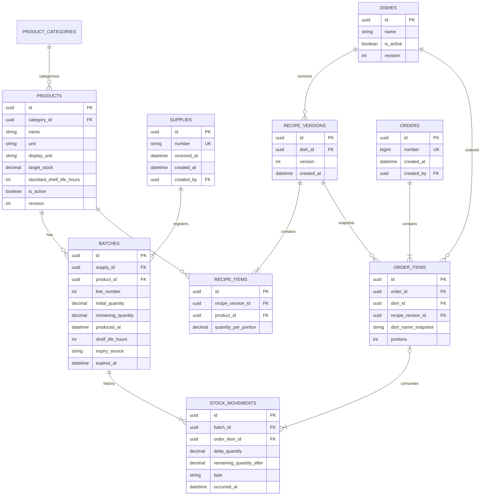
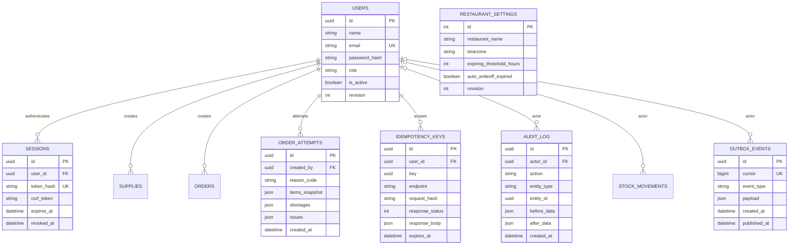

# Кладовая — ресторанный склад

Кладовая помогает ресторану принимать поставки отдельными партиями, видеть годные и просроченные остатки, оформлять заказы с атомарным списанием ингредиентов, автоматически формировать стоп-лист и рекомендовать закупки и блюда для приоритетной продажи. Название проекта в репозитории и Docker Compose — `flagman`.

Этот README — согласованная спецификация реализации по ТЗ и содержимому `design.zip`, а не отчёт о готовом приложении. Сейчас в репозитории есть каркас Go-сервиса, подключение PostgreSQL, `GET /api/v1/healthcheck`, стартовый React/Vite-проект и инфраструктура. Остальные API, миграции и бизнес-экраны предстоит реализовать.

## Навигация

- [Экраны и соответствие ТЗ](#экраны-и-соответствие-тз)
- [Принятые решения](#принятые-решения)
- [Учёт и алгоритмы](#учёт-и-алгоритмы)
- [REST API](#rest-api)
- [Администрирование и вход](#администрирование-и-вход)
- [Дополнительные функции](#дополнительные-функции)
- [База данных и диаграммы](#база-данных-и-диаграммы)
- [Frontend и состояния интерфейса](#frontend-и-состояния-интерфейса)
- [Стек и запуск](#стек-и-запуск)
- [Порядок реализации и приёмка](#порядок-реализации-и-приёмка)

## Экраны и соответствие ТЗ

### Что доступно в архиве дизайна

Изучены `design/app.js`, `index.html`, `styles.css`, `DEVELOPMENT-HANDOFF.md`, файлы плагина `figma-handoff` и оба PNG: `kladovaya-handoff.png` и `kladovaya-mobile-admin.png`.

HTML-прототип содержит шесть основных разделов, пять дополнительных экранов сценариев и страницу компонентов. Для основных разделов предусмотрены загрузка, пустой список, отсутствие результатов и ошибка загрузки. Переключатель ширины показывает Desktop 1440, Tablet 1024 и Mobile 390. Один и тот же экран адаптируется под ширину.

Руководство сообщает о 181 экране/состоянии и 295 компонентах в [Figma](https://www.figma.com/design/rP1JjraHWpqUFwm5c2bgJb). Полного экспорта этих фреймов в ZIP нет: плагин только навигирует по существующему файлу Figma. Поэтому основные разделы сопоставлены по коду прототипа и PNG, а вход и большая часть админки — по описанию в руководстве. Поля, которых нет в доступных материалах, ниже обозначены как решения для реализации.

| Экран / состояние | Поля и действия дизайна | API реализации |
|---|---|---|
| Обзор | Число истекающих и просроченных партий, стоп-лист, проблемные партии, продвижение блюд, закупки | `GET /dashboard` |
| Склад | Поиск, фильтры, продукт, доступное количество, число партий, ближайший срок, статус, физический остаток | `GET /inventory` |
| Раскрытые партии продукта | Поставка, остаток партии, дата годности, оставшееся время; FEFO | `GET /products/{id}/batches` |
| Поставки | Поиск по номеру, номер, дата, число позиций, переход в детали | `GET /supplies` |
| Детали поставки | Данные поставки, продукты, исходное количество, срок, переход на склад | `GET /supplies/{id}` |
| Новая поставка | Номер, дата, строки продукта, количество, единица, «Годен до», добавление/удаление строк | `GET /products`, `POST /supplies` |
| Поставка принята | Номер, принятые позиции, обновлённый стоп-лист | Ответ `POST /supplies`, затем `GET /dashboard` |
| Заказы | Поиск по номеру/блюду, дата, состав, статус; в прототипе есть отклонённая попытка | `GET /orders`; отдельная вкладка отказов — `GET /order-attempts` |
| Новый заказ | Поиск блюд, состав на порцию, счётчик порций, корзина, агрегированная проверка ингредиентов | `GET /dishes`, `POST /orders/check`, `POST /orders` |
| Заказ создан / детали заказа | Номер, позиции, продукты и партии списания, переход на склад | Ответ `POST /orders`, `GET /orders/{id}` |
| Стоп-лист | Недоступные блюда, причины, доступно и требуется на порцию, переход к ингредиенту/закупкам | `GET /stop-list` |
| Рекомендации: продвигать блюда | Ранг, приоритет, причина, партия, срок, расход на порцию, доступные порции, состав | `GET /hot-offers`, `GET /dishes/{id}` |
| Рекомендации: закупить продукты | Остаток, сколько докупить, причина, переход на склад | `GET /procurement-recommendations` |
| Админка: продукты | Категория, название, единица, стандартный срок, запас, активность | `/products`, `/product-categories` — чтение и изменение |
| Админка: рецептуры | Название блюда, ингредиенты, расход на порцию, добавление строк, доступные порции, сохранение | `/dishes`, `POST /dishes/preview` |
| Админка: пользователи и роли | Имя, email, роль, активность | `/users`, `GET /roles` |
| Админка: настройки | Ресторан, часовой пояс, порог истечения, автосписание | `GET /settings`, `PATCH /settings` |
| Админка: журнал | Кто, когда, какое действие и объект | `GET /audit-log` |
| Вход, истёкшая сессия, нет доступа | Аутентификация, выход, проверка прав | `/auth/login`, `/auth/me`, `/auth/logout`; HTTP `401`/`403` |
| Компоненты и адаптивные варианты | UI-kit, цвета, контролы, Desktop/Tablet/Mobile | Отдельного бизнес-API не требуют |

Все пути таблицы имеют префикс `/api/v1`.

### Покрытие требований

| Требование | Реализация | Объём |
|---|---|---|
| Приём поставки, идентификатор, номер, дата создания | `supplies` + `batches`; атомарный `POST /supplies` | Основной сценарий |
| Один продукт в нескольких партиях, разные сроки | Отдельная запись `batches` на каждую строку поставки | Основной сценарий |
| Количество и срок каждой партии | `remaining_quantity`, `expires_at`, серверный статус и время до истечения | Основной сценарий |
| Проверка всех блюд заказа и отказ при дефиците | Агрегация потребности по продуктам, повторная проверка под блокировками | Основной сценарий |
| Списание и FEFO | `stock_movements` на каждое распределение по партии | Основной сценарий |
| Автоматический стоп-лист | Расчёт доступных порций по актуальным годным остаткам | Основной сценарий |
| Выявление истекающих и просроченных партий | Склад, обзор, фильтры, уведомления | Основной сценарий |
| Необходимые закупки | Пополнение до `target_stock` с объяснением и связанными блюдами | Основной сценарий |
| Приоритет продажи, причина, обновление | FEFO-симуляция одной порции, ранжирование и объяснение | Включено в основной сценарий по руководству дизайна |
| Справочники, пользователи, настройки и журнал | Дополнительные API и таблицы | Расширение дизайна |
| Автосписание, аналитика, прогноз, SSE, генератор событий | Контракты приведены ниже | Дополнительные возможности ТЗ |

## Принятые решения

| Расхождение | Решение для реализации |
|---|---|
| В форме поставки «Годен до», в прежнем REST — производство и срок | Приём поддерживает два взаимоисключающих способа: явный `expires_at` или `produced_at` + срок. Простой UI использует первый |
| В форме редактируется «Дата создания» | Поле переименовывается в «Дата приёмки» и отправляет `received_at`. `created_at` задаёт сервер; в деталях показываются обе даты |
| Прототип предупреждает о просрочке, но позволяет её принять | Обычная поставка отклоняет уже просроченную строку с `422`; вся поставка не сохраняется |
| Дизайн показывает кг/л, рецептура — г/мл | API и БД используют `g`, `ml`, `pcs`. `display_unit` задаёт кг/л/шт. для отображения. Клиент переводит ввод в базовую единицу |
| «Минимальный остаток» и «Целевой запас» | Один параметр `target_stock`: количество, до которого пополняют продукт. В форме подпись «Целевой запас для закупок». Отдельный порог закупки пока не вводится |
| В истории дизайна есть «Отклонённый заказ» | Заказ создаётся только при успехе. Отказы хранятся как `order_attempts` и показываются во вкладке «Отклонённые попытки», без номера успешного заказа |
| Статус продукта может скрывать одновременно годные и просроченные партии | Остатки и признаки возвращаются отдельно. Фильтры проверяют количества, а не один приоритетный бейдж |
| «Нет в наличии» в прототипе исключает продукт с одной просрочкой | Фильтр означает `available_quantity = 0`; при наличии просрочки UI дополнительно показывает физический остаток |
| Номер поставки отображается как номер партии | У партии есть отдельный UUID и строка поставки. Подпись: «Поставка №104 · строка 1», чтобы различать партии одного продукта из одной поставки |
| «Посмотреть состав» в рекомендациях сразу открывает заказ | Открывается состав блюда; отдельное действие «Добавить в заказ» переносит одну порцию в корзину |
| В макете админка и роль обозначены демонстрационно | Роль приходит из `/auth/me`, сервер проверяет права на каждом запросе |
| Фиксированные даты и причины рекомендаций в JS | В реализации всё рассчитывает сервер относительно актуального времени; demo seed также строится относительно текущего времени |
| В прототипе всем предложениям задан «Высокий приоритет» | Балл и уровень срочности рассчитываются по описанному алгоритму; подпись больше не фиксированная |

## Учёт и алгоритмы

### Единицы, сроки и остатки

Один продукт имеет одну неизменяемую базовую единицу. Масса — граммы, объём — миллилитры, штучные продукты — целые штуки. `1000.000 g` отображаются как `1 кг`; `2000.000 ml` — как `2 л`. Все складские количества, рецептуры, запасы и движения используют базовую единицу. Нельзя суммировать разные продукты в один показатель количества без единиц.

Количества передаются JSON-строками и хранятся как `numeric(14,3)` — точный десятичный тип [PostgreSQL](https://www.postgresql.org/docs/18/datatype-numeric.html). Сервер использует точную десятичную арифметику или целые тысячные единицы, без `float64` в учёте. Для `pcs` дробная часть должна быть нулевой. Допускается не больше трёх знаков после запятой; клиент не округляет молча ввод с большей точностью.

Даты — RFC 3339 с часовым поясом. Сервер хранит `timestamptz` и отвечает в UTC. UI использует `settings.timezone`, по умолчанию `Europe/Moscow`. Время `T` фиксируется для согласованного чтения одного ответа; после ожидания блокировок при записи фиксируется новое время проверки.

Статусы партии:

- `depleted`: остаток равен нулю;
- `expired`: остаток положителен и `expires_at <= T`;
- `expiring`: остаток положителен и `0 < expires_at - T <= expiring_threshold_hours`;
- `valid`: остальные партии с положительным остатком и будущим сроком.

Порог по умолчанию — 24 часа. Он меняет предупреждения и рекомендации, но не дату годности.

Для продукта:

```text
physical_quantity  = сумма всех remaining_quantity
available_quantity = сумма remaining_quantity партий с expires_at > T
expiring_quantity  = часть available_quantity в пределах порога истечения
expired_quantity   = сумма remaining_quantity партий с expires_at <= T
physical_quantity  = available_quantity + expired_quantity
```

`expiring_quantity` уже входит в доступный остаток. Ближайший срок берётся только среди годных партий с положительным остатком; если их нет, `nearest_expires_at = null`. Число партий на складе включает годные и просроченные партии с ненулевым остатком; израсходованные доступны в истории.

### Поставки

Каждая строка поставки становится самостоятельной партией. Повтор продукта допустим, в том числе с одинаковой датой годности. Номер поставки — непустая строка после удаления крайних пробелов, уникальная в одном ресторане, чувствительная к регистру.

В режиме `explicit` вводится дата «Годен до». Дата производства может быть передана как дополнительный факт, но не обязательна. В режиме `calculated` сервер рассчитывает `expires_at = produced_at + shelf_life_hours`; если срок не передан, использует текущий стандарт продукта и сохраняет его копию в партии. Время приёмки не подменяет время производства. Изменение стандарта продукта не меняет уже принятые партии.

Проверки: минимум одна строка, активный продукт, количество больше нуля, `received_at <= T`, `produced_at <= received_at` при наличии, `expires_at > received_at` и `expires_at > T`. Неверная строка отклоняет всю поставку. Принятые поставки не редактируются и не удаляются; исправления оформляются отдельным списанием или новой поставкой с новым номером.

### Заказы, FEFO и стоп-лист

Потребность заказа по каждому продукту — сумма `quantity_per_portion × portions` по всем позициям. Повтор одного блюда в запросе объединяется до проверки лимитов. Все ингредиенты проверяются вместе.

`POST /orders/check` ничего не резервирует и не создаёт заказ. `POST /orders` заново читает актуальные рецептуры и остатки в транзакции. Блюда без рецептуры или отключённые блюда заказать нельзя. Если рецептура изменилась после проверки и клиент прислал прежнюю версию, сервер отвечает `409 RECIPE_CHANGED`.

Для каждой потребности партии выбираются по `(expires_at, received_at, id)` по возрастанию. Просрочка и нулевые остатки исключены. Если нужна часть партии, остаток уменьшается на фактически использованное количество. Например, при остатках 300 г и 500 г и потребности 400 г списываются 300 г из ранней партии и 100 г из следующей.

```text
available_portions(dish) = min по всем ингредиентам floor(available / per_portion)
is_available = dish.is_active AND recipe_exists AND available_portions > 0
```

Автоматический стоп-лист содержит активные блюда с `is_available = false`. Отключённые администратором блюда показываются в административном каталоге, но не в автоматическом стоп-листе. Причины: `ingredient_shortage`, `only_expired_stock`, `recipe_missing`. Дефицит в стоп-листе рассчитывается на одну порцию; проверка заказа — на всю корзину.

Порции разных блюд нельзя складывать: ингредиенты могут быть общими. После поставки, заказа, списания, изменения рецептуры или истечения срока доступность вычисляется заново. Отдельной таблицы стоп-листа нет.

### Транзакции и конкурентная работа

Все операции, меняющие склад, используют один порядок блокировок. Запись сначала блокирует связанные блюда по ID, если операция использует рецептуру, затем продукты по ID, затем их партии. Изменение рецептуры также блокирует блюдо; изменение продукта блокирует продукт. Проверка прав и ключ идемпотентности выполняются до предметных блокировок.

Внутри транзакции после блокировок перечитываются остатки, проверяются сроки и потребность. Заказ, позиции, уменьшение партий, движения, журнал и событие outbox сохраняются вместе. При дефиците заказ и движения не создаются: фиксируется только отклонённая попытка и ответ идемпотентности. Повтор при техническом сбое транзакции ограничен и безопасен благодаря идемпотентности.

Сервер блокирует строки продуктов, включая продукты с нулевым запасом: это согласует параллельную поставку, заказ и списание. Блокировки удерживаются до конца транзакции согласно [документации PostgreSQL](https://www.postgresql.org/docs/18/explicit-locking.html). `remaining_quantity >= 0` дополнительно защищается ограничением БД. Склад нельзя изменять прямым `PATCH remaining_quantity`.

### Закупки и продвижение блюд

Для продукта с заданным `target_stock`:

```text
recommended_quantity = max(0, target_stock - available_quantity)
```

`null` отключает контроль запаса, `0` означает нулевой целевой запас. Выводятся только продукты с положительной рекомендацией. Сначала идут продукты, блокирующие больше блюд стоп-листа, затем продукты с нулевым годным остатком, далее сортировка по имени. Причины: `below_target`, `no_valid_stock`, `only_expired_stock`. Это пополнение до заданной цели, а не прогноз спроса.

Горячие предложения включают только доступные блюда. Сервер симулирует FEFO для одной порции и учитывает только истекающие партии, из которых порция действительно будет расходовать продукт. Для каждой такой партии:

```text
H = expiring_threshold_hours
h = оставшиеся часы годности, 0 < h <= H
urgency = 1 - h / H
use_share = used_for_one_portion / remaining_quantity
batch_score = 100 × urgency × use_share
priority_score = max(batch_score по затронутым истекающим партиям)
```

Баллы сравниваются без промежуточного округления. Сортировка: `priority_score DESC`, ближайший срок `ASC`, ID блюда. На границе `h = H` балл равен нулю, но блюдо уже допускается в рекомендации. `priority_level`: `high`, если ближайший срок не больше `H/4`; `medium` — не больше `H/2`; иначе `low`. Уровень показывает срочность, место в списке — итоговый балл.

Ответ содержит проблемные партии, остаток каждой, расход на порцию, время до истечения и понятную причину. Общие ингредиенты не резервируются рекомендацией: доступность всего заказа проверяется отдельно. При уменьшении `h` с неизменными остатками приоритет блюда увеличивается.

## REST API

### Общие соглашения

Базовый путь — `/api/v1`. Обычные запросы и ответы — JSON; SSE отдельно. Идентификаторы сущностей — UUID. Номер заказа — серверная последовательность и JSON-строка, номер поставки — введённая строка. Пропуски номеров заказов допустимы. Во всех примерах `<product-id>`, `<dish-id>` и подобные значения обозначают настоящие UUID из API.

Для коллекций: `page=1`, `page_size=50`, максимум 100, стабильная сортировка с ID в качестве последнего критерия. Сортировка допускается только из перечня конкретного эндпоинта. Неизвестные значения фильтра и неверная пагинация дают `422`. Все фильтры объединяются через AND. Поиск без учёта регистра. `from` включительно, `to` исключительно — фильтры времени в RFC 3339.

Обёртка списка:

```json
{
  "items": [],
  "total": 0,
  "page": 1,
  "page_size": 50,
  "meta": {"server_time": "2026-10-09T09:00:00Z", "request_id": "req-123"}
}
```

`total` — число элементов после всех фильтров до пагинации. Одиночный ресурс возвращается напрямую. `meta.server_time` в ответах с расчётами задаёт момент расчёта. Лимиты записи: 1–100 строк поставки или корзины, 1–100 ингредиентов рецепта, 1–1000 порций каждого блюда после объединения повторов. Значения количеств должны укладываться в `numeric(14,3)`.

| Код | Когда |
|---|---|
| `200` | Чтение, проверка, обновление; проверка с `can_create=false` тоже успешна |
| `201` | Создан продукт, блюдо, категория, пользователь, поставка, заказ, ручное списание |
| `204` | Выход из сессии |
| `400` | Невалидный JSON |
| `401` | Нет действующей сессии |
| `403` | Недостаточно прав или CSRF-проверка не пройдена |
| `404` | Объект не найден |
| `409` | Дефицит при оформлении, дубликат номера, смена рецепта, устаревшая ревизия, заблокированная единица, конфликт идемпотентности |
| `422` | Ошибки полей, ссылок, фильтров, количества, даты |
| `429` | Ограничение частоты запросов |
| `500` / `503` | Внутренняя ошибка / временная недоступность; детали БД клиенту не раскрываются |

Единая ошибка:

```json
{
  "error": {
    "code": "VALIDATION_ERROR",
    "message": "Проверьте поля поставки",
    "details": {
      "fields": [{"path": "items[0].quantity", "code": "must_be_positive", "message": "Количество должно быть больше нуля"}]
    }
  },
  "request_id": "req-123"
}
```

Для записи поставки, заказа и ручного списания обязателен `Idempotency-Key: <uuid>`. Ключ связан с пользователем, методом/путём и хешем тела. В транзакции сохраняются HTTP-статус и тело завершённого предметного результата, включая отказ по дефициту. Повтор возвращает тот же статус/тело, не меняет склад и не создаёт второй отказ. Другое тело с тем же ключом — `409 IDEMPOTENCY_CONFLICT`; незавершённый параллельный запрос — `409 REQUEST_IN_PROGRESS` с `Retry-After`.

Срок хранения результата — минимум 24 часа; после него прежний ключ может считаться новым. При изменении тела или новой попытке после отказа клиент создаёт новый ключ. После сетевого сбоя сначала повторяет исходный ключ. Ошибки разбора, доступа и валидации до предметной транзакции не занимают ключ.

Для изменения справочников, пользователей и настроек тело содержит обязательное `expected_revision` — целое число из последнего прочитанного ресурса. Сервер сравнивает его с текущей ревизией под блокировкой, затем увеличивает revision при успехе. Устаревшее значение — `409 REVISION_CONFLICT` с `details.current_revision`; отсутствие — `422`. Этот механизм относится к редактируемым данным: изменение складской доступности блюда само по себе не увеличивает revision его определения.

Пример редактирования продукта: `PATCH /products/{id}` с телом `{"expected_revision":1,"target_stock":"6000.000"}`. `expected_revision` не сохраняется как свойство объекта. В создании нового объекта оно не требуется.

### Каталог основных эндпоинтов

| Метод и путь | Результат | Параметры |
|---|---|---|
| `GET /products` | Список `Product` для формы и каталога | `search`, `category_id`, `is_active=all\|true\|false` (по умолчанию `true`), `sort=name` |
| `GET /inventory` | Список `InventoryItem`, счётчики фильтров и внимание по партиям | `search`, `category_id`, `filter=all\|expiring\|expired\|out_of_stock\|deficit`, `sort=name\|nearest_expires_at` |
| `GET /products/{id}/batches` | Список `Batch` данного продукта | `status=all\|valid\|expiring\|expired\|depleted`, `supply_id`, `sort=expires_at\|-created_at`; без status — все ненулевые |
| `GET /supplies` | Список `SupplySummary` | `search` по номеру, `from`, `to` по created_at, `sort=-created_at` |
| `GET /supplies/{id}` | `SupplyDetail` с исходными строками и текущими партиями | — |
| `POST /supplies` | `201 SupplyDetail`, регистрация поступления | `Idempotency-Key`, тело ниже |
| `GET /dishes` | Список `Dish` с рецептом и доступностью | `search`, `is_active=all\|true\|false` (по умолчанию `true`), `availability=all\|available\|unavailable`, `sort=name` |
| `GET /dishes/{id}` | Одно блюдо, рецепт, доступность, ревизия | — |
| `GET /stop-list` | Недоступные активные `Dish` в том же формате | `search`, `sort=name` |
| `POST /orders/check` | `OrderCheck`, без изменения склада | Тело корзины ниже |
| `POST /orders` | `201 OrderDetail`, повторная проверка и списание | `Idempotency-Key`, тело корзины ниже |
| `GET /orders` | Список `OrderSummary` успешных заказов | `search` по номеру/названию блюда, `from`, `to`, `sort=-created_at` |
| `GET /orders/{id}` | `OrderDetail` с фактическим списанием | — |
| `GET /order-attempts` | Отклонённые предметные попытки оформления | `search` по названию блюда/ID попытки, `from`, `to`, `reason_code`, `sort=-created_at` |
| `GET /procurement-recommendations` | Список `ProcurementItem` | `search`, `category_id`; фиксированный приоритет из алгоритма |
| `GET /hot-offers` | Список `HotOffer` | `search`; фиксированная сортировка приоритета |
| `GET /dashboard` | Сводка и карточки обзора | — |
| `GET /healthcheck` | Состояние процесса | Публичный, уже есть в каркасе |

`sort=-created_at` означает убывание. Для `InventoryItem.nearest_expires_at` null идёт последним. `GET /orders` не возвращает отказы, `GET /order-attempts` не возвращает успешные заказы. Поиск в истории использует сохранённые названия позиций, а не текущее название блюда.

### Объекты продуктов, склада и партий

`Product`:

```json
{
  "id": "<product-id>", "name": "Моцарелла",
  "category": {"id": "<category-id>", "name": "Молочные продукты"},
  "unit": "g", "display_unit": "kg",
  "standard_shelf_life_hours": 72, "target_stock": "4000.000",
  "is_active": true, "revision": 1, "created_at": "2026-10-07T06:00:00Z"
}
```

`InventoryItem`:

```json
{
  "product": {"id": "<product-id>", "name": "Моцарелла", "unit": "g", "display_unit": "kg", "is_active": true, "category": {"id": "<category-id>", "name": "Молочные продукты"}},
  "physical_quantity": "4000.000", "available_quantity": "4000.000",
  "expiring_quantity": "1800.000", "expired_quantity": "0.000",
  "target_stock": "4000.000", "deficit_quantity": "0.000", "batches_count": 2,
  "nearest_expires_at": "2026-10-10T03:00:00Z", "remaining_seconds": 64800,
  "has_expiring": true, "has_expired": false, "is_out_of_stock": false,
  "status": "expiring"
}
```

`status` для основного бейджа: сначала `expired`, если есть просрочка; затем `expiring`; затем `normal`, если есть годный остаток; иначе `out_of_stock`. При смешанных партиях UI может показать несколько признаков. `deficit_quantity` равен рекомендации закупки, либо `null`, если цель не задана.

Дополнения к обёртке `GET /inventory`:

```json
{
  "counts": {"all": 6, "expiring": 1, "expired": 1, "out_of_stock": 2, "deficit": 2},
  "attention_batches": [
    {"batch_id": "<batch-id>", "product_id": "<product-id>", "product_name": "Моцарелла", "supply_id": "<supply-id>", "supply_number": "104", "line_number": 1, "remaining_quantity": "1800.000", "unit": "g", "status": "expiring", "expires_at": "2026-10-10T03:00:00Z", "remaining_seconds": 64800}
  ],
  "attention_total": 2
}
```

`counts` учитывает поиск и категорию, но игнорирует выбранный статус и пагинацию. Фильтры пересекаются: один продукт может иметь просрочку и истекающую годную партию. `attention_batches` — первые 20 проблемных партий по `expires_at, id` в том же поиске/категории; `attention_total` — полное число, UI показывает переход к соответствующему фильтру. Это не количество продуктов.

`Batch`:

```json
{
  "id": "<batch-id>", "product_id": "<product-id>", "unit": "g",
  "supply": {"id": "<supply-id>", "number": "104", "received_at": "2026-10-07T06:00:00Z"},
  "line_number": 1, "initial_quantity": "1800.000", "remaining_quantity": "1800.000",
  "produced_at": null, "shelf_life_hours": null, "expiry_source": "explicit",
  "expires_at": "2026-10-10T03:00:00Z", "remaining_seconds": 64800,
  "status": "expiring", "created_at": "2026-10-07T06:00:00Z"
}
```

`remaining_seconds` — знаковое целое число: отрицательное для просрочки; для израсходованной партии тоже описывает её дедлайн, а статус остаётся `depleted`. Израсходованная партия не включается в доступные остатки. Детали поставки возвращают все её партии, включая израсходованные.

### Поставки: запросы и ответы

`POST /supplies`, основной способ из дизайна:

```json
{
  "number": "109",
  "received_at": "2026-10-09T09:00:00Z",
  "items": [
    {"product_id": "<chicken-id>", "quantity": "3000.000", "expires_at": "2026-10-11T09:00:00Z"},
    {"product_id": "<cream-id>", "quantity": "2000.000", "expires_at": "2026-10-14T09:00:00Z"}
  ]
}
```

Альтернативная строка с расчётом срока:

```json
{"product_id": "<product-id>", "quantity": "1000.000", "produced_at": "2026-10-09T06:00:00Z", "shelf_life_hours": 24}
```

В рассчитанной строке `expires_at` отсутствует. Если отсутствует и `shelf_life_hours`, используется стандарт продукта; если стандарта нет — `422 SHELF_LIFE_REQUIRED`. В явной строке `shelf_life_hours` запрещён, а `produced_at` допустим как необязательный факт. Итоговый срок всегда хранится явно. Даты примеров иллюстративные; при отправке нужны актуальные.

`SupplySummary` содержит `id`, `number`, `created_at`, `received_at`, `items_count`, `created_by: {id,name}`, `status: "received"`. `SupplyDetail` дополняет его `items`: каждая строка содержит `product: {id,name,unit,display_unit}` и `batch: Batch`. Исходное количество берётся из `batch.initial_quantity`, текущий остаток — из `batch.remaining_quantity`. Успешный POST возвращает такой же объект, как GET деталей; снабжается `Location: /api/v1/supplies/{id}`.

### Блюда, стоп-лист и корзина

`Dish`:

```json
{
  "id": "<dish-id>", "name": "Пицца «Маргарита»", "description": null,
  "is_active": true, "revision": 1, "recipe_version": 1,
  "recipe": [
    {"product_id": "<mozzarella-id>", "product_name": "Моцарелла", "unit": "g", "quantity_per_portion": "120.000"},
    {"product_id": "<tomato-id>", "product_name": "Томаты", "unit": "g", "quantity_per_portion": "100.000"},
    {"product_id": "<dough-id>", "product_name": "Тесто для пиццы", "unit": "pcs", "quantity_per_portion": "1.000"}
  ],
  "is_available": true, "available_portions": "10", "shortages": [], "unavailability_reasons": [],
  "meta": {"server_time": "2026-10-09T09:00:00Z"}
}
```

`available_portions` — строка целого числа; заказанные `portions` — JSON-число. `unavailability_reasons` — массив кодов. Для `recipe_missing` количество равно `"0"`, `shortages` пуст; для отключённого блюда причина `dish_inactive`. Для обычного дефицита возвращаются конкретные `Shortage`.

`Shortage`:

```json
{
  "product_id": "<chicken-id>", "product_name": "Куриное филе", "unit": "g",
  "required_quantity": "300.000", "available_quantity": "0.000",
  "missing_quantity": "300.000", "expired_quantity": "0.000",
  "reason_code": "ingredient_shortage"
}
```

Если годного остатка недостаточно, а физический остаток состоит только из просрочки, причина — `only_expired_stock`. Если часть годного остатка есть, причина — `ingredient_shortage`, даже при наличии просрочки.

`POST /orders/check` и `POST /orders` принимают одну структуру:

```json
{
  "items": [
    {"dish_id": "<dish-id>", "portions": 2, "recipe_version": 1}
  ]
}
```

`recipe_version` необязателен для интеграций: тогда применяется актуальная рецептура. UI всегда передаёт версию из `/dishes`; успешный check возвращает актуальные версии для оформления.

`OrderCheck` — `200`, включая случаи дефицита:

```json
{
  "can_create": false,
  "items": [{"dish_id": "<chicken-pizza-id>", "dish_name": "Пицца с курицей", "portions": 2, "recipe_version": 1}],
  "requirements": [
    {"product_id": "<chicken-id>", "product_name": "Куриное филе", "unit": "g", "required_quantity": "300.000", "available_quantity": "0.000", "missing_quantity": "300.000"}
  ],
  "shortages": [{"product_id": "<chicken-id>", "product_name": "Куриное филе", "unit": "g", "required_quantity": "300.000", "available_quantity": "0.000", "missing_quantity": "300.000", "expired_quantity": "0.000", "reason_code": "ingredient_shortage"}],
  "issues": [],
  "meta": {"server_time": "2026-10-09T09:00:00Z"}
}
```

`requirements` содержит все ингредиенты, включая достаточные; `shortages` — только недостающие. `issues` описывает недоступность по иной причине: `{dish_id, code, message, current_recipe_version}` для отключённого блюда, отсутствующего или изменённого рецепта. `can_create=true` только при пустых `shortages` и `issues`. Неизвестный ID или неверная форма тела — `422`, а не предметный дефицит.

`POST /orders` при дефиците отвечает `409 INSUFFICIENT_STOCK` с `error.details.shortages`, `error.details.requirements` и `error.details.attempt_id`. При изменении рецепта — `409 RECIPE_CHANGED` с `details.issues`; при отключённом/неполном блюде — `409 DISH_UNAVAILABLE`. Сеть/серверная ошибка не считается отказом по дефициту.

### Заказы и история списания

`OrderDetail`, в том числе ответ успешного POST:

```json
{
  "id": "<order-id>", "number": "247", "status": "completed",
  "created_at": "2026-10-09T09:00:00Z", "created_by": {"id": "<user-id>", "name": "Оператор"},
  "items": [
    {
      "id": "<order-item-id>", "dish_id": "<dish-id>", "dish_name": "Пицца «Маргарита»", "portions": 2, "recipe_version": 1,
      "allocations": [
        {"movement_id": "<movement-id>", "product_id": "<mozzarella-id>", "product_name": "Моцарелла", "unit": "g", "batch_id": "<batch-id>", "supply_id": "<supply-id>", "supply_number": "104", "line_number": 1, "quantity": "240.000", "batch_remaining_quantity_after": "1560.000"}
      ]
    }
  ]
}
```

В примере сокращён состав списаний: реальный ответ обязательно содержит также томаты и тесто. Распределение сохраняется по позиции заказа и конкретной партии. Если два блюда используют одну партию, создаются отдельные движения; сумма согласована с общей потребностью. Позиции распределяются стабильно по ID блюда после агрегации, партии — по FEFO.

`batch_remaining_quantity_after` — остаток сразу после конкретного движения, сохранённый в журнале, а не текущий остаток партии. `GET /orders/{id}` возвращает исторические факты и сохранённое название блюда независимо от дальнейшего изменения рецепта. POST возвращает `Location: /api/v1/orders/{id}`.

`OrderSummary`: `id`, `number`, `created_at`, `status`, `created_by`, `items: [{dish_id,dish_name,portions,recipe_version}]`, `total_portions`. Список не включает подробные allocations.

Элемент `/order-attempts`: `id`, `created_at`, `created_by`, `reason_code`, `items` со снимками названий, порциями и версиями рецептов, `shortages`, `issues`. Попытка не имеет `order_id`/номера заказа и не уменьшает остатки. Предварительные вызовы check в историю не попадают.

### Рекомендации и обзор

`ProcurementItem`:

```json
{
  "product_id": "<chicken-id>", "product_name": "Куриное филе", "unit": "g", "display_unit": "kg",
  "available_quantity": "0.000", "expired_quantity": "0.000", "target_stock": "3000.000",
  "recommended_quantity": "3000.000", "reason_codes": ["below_target", "no_valid_stock"],
  "reason": "Годного остатка нет; пополнить до целевого запаса 3 кг",
  "affected_dishes": [{"id": "<chicken-pizza-id>", "name": "Пицца с курицей"}]
}
```

`affected_dishes` — блюда стоп-листа, для которых этот продукт входит в дефицит, а не все блюда с этим продуктом. При `target_stock=null` продукт не включается; UI стоп-листа всё равно показывает дефицит.

`HotOffer`:

```json
{
  "dish": {"id": "<dish-id>", "name": "Пицца «Маргарита»", "recipe_version": 1},
  "rank": 1, "priority_score": "1.6667", "priority_level": "low", "available_portions": "10",
  "reason": "Моцарелла из поставки №104 истечёт через 18 часов; порция использует 120 г из этой партии",
  "problem_batches": [
    {"batch_id": "<batch-id>", "product_id": "<mozzarella-id>", "product_name": "Моцарелла", "supply_id": "<supply-id>", "supply_number": "104", "line_number": 1, "unit": "g", "remaining_quantity": "1800.000", "used_for_one_portion": "120.000", "expires_at": "2026-10-10T03:00:00Z", "remaining_seconds": 64800}
  ]
}
```

`rank` — место в полном списке до пагинации. `priority_score` — десятичная строка с четырьмя знаками для отображения. Состав открывается по ID блюда. Причины строятся из расчёта и локализуются на русском; кодовые поля позволяют клиенту менять формат текста.

`GET /dashboard`:

```json
{
  "expiring_batches_count": 1, "expired_batches_count": 1, "stop_list_dishes_count": 2,
  "out_of_stock_products_count": 2,
  "attention_batches": [], "attention_total": 2,
  "hot_offers": [], "procurement_recommendations": [],
  "settings": {"restaurant_name": "Бистро №12", "timezone": "Europe/Moscow", "expiring_threshold_hours": 24},
  "meta": {"server_time": "2026-10-09T09:00:00Z", "request_id": "req-123"}
}
```

В примере массивы сокращены. Реальный ответ содержит первые 20 проблемных партий в формате внимания склада, первые 3 `HotOffer` и первые 3 `ProcurementItem`. Числовые счётчики относятся ко всему складу, а не к видимому списку. Роль оператора получает `procurement_recommendations: []`, поскольку закупки ей не разрешены; роль кладовщика получает `hot_offers: []`. Ролевое ограничение не меняет счётчики доступности.

## Администрирование и вход

Админка — расширение дизайна. Её API нужны для полноценной реализации описанных экранов. Основной складской сценарий можно разрабатывать сначала со справочниками из seed; до подключения входа demo-режим допускается только локально. В итоговой версии все предметные эндпоинты требуют сессию.

### Роли

| Возможность | `admin` | `manager` | `storekeeper` | `order_operator` |
|---|---|---|---|---|
| Обзор, чтение склада и партий | Да | Да | Да | Да |
| Поставки, закупки | Да | Да | Да | Нет |
| Меню, стоп-лист, горячие предложения | Да | Да | Нет | Да |
| Проверка/создание заказа, история заказов и отказов | Да | Да | Нет | Да |
| Ручное списание, история движений | Да | Да | Да | Нет |
| Аналитика и прогноз | Да | Да | Нет | Нет |
| Изменение продуктов, категорий, рецептур | Да | Нет | Нет | Нет |
| Пользователи, настройки, журнал действий | Да | Нет | Нет | Нет |

`GET /products` разрешён всем четырём ролям для поиска и чтения; изменение — только admin. `GET /dishes` разрешён admin/manager/order_operator; администрация может запросить неактивные записи. `GET /settings` и `/auth/me` возвращают всем активным пользователям настройки, нужные оболочке. Права на сервере проверяются независимо от видимости кнопок. Запрос чужого раздела — `403`.

### Эндпоинты входа

| Метод и путь | Тело / ответ |
|---|---|
| `POST /auth/login` | `{email,password}` → `200 {user,csrf_token,session_expires_at}` и session cookie |
| `GET /auth/me` | `200 {user,csrf_token,session_expires_at,settings}`; без сессии — `401` |
| `POST /auth/logout` | Без тела → `204`, отзыв текущей сессии и удаление cookie |
| `GET /roles` | Список `{code,name}` из четырёх фиксированных ролей; admin |

`user`: `{id,name,email,role,is_active,revision,created_at,last_login_at}`. `role` — код роли; `/roles` даёт русское название. Пароль и его хеш никогда не входят в ответ. Cookie — непрозрачный случайный session token, в БД хранится только его хеш. Сессия живёт 12 часов; отключение пользователя и смена роли/пароля отзывают его сессии.

Для всех изменяющих запросов с сессией обязателен `X-CSRF-Token`, полученный из login/me. Проверяются Origin и CSRF-токен; login защищается проверкой Origin и ограничением частоты. Cookie: `HttpOnly`, `SameSite=Lax`, в HTTPS — `Secure`; локально через HTTP `Secure=false`. Основной UI обращается к `/api/v1` через nginx того же origin. При прямом доступе к отдельному API-хосту CORS допускает только заданный frontend origin с credentials.

### Категории и продукты

| Метод и путь | Действие |
|---|---|
| `GET /product-categories` | Список `{id,name,revision}`, `search`, `sort=name` |
| `GET /product-categories/{id}` | Одна категория с revision |
| `POST /product-categories` | `{name}` → `201` категория |
| `PATCH /product-categories/{id}` | `{name,expected_revision}` → обновлённая категория |
| `GET /products/{id}` | Полный `Product` с revision |
| `POST /products` | Тело ниже → `201 Product` |
| `PATCH /products/{id}` | Изменяемые поля продукта и `expected_revision` → `Product` |

Чтение категорий разрешено всем ролям, изменение — admin. Имена категорий и продуктов обязательны (1–200 символов после trim); для данного проекта уникальны без учёта регистра. Категория продукта обязательна.

```json
{
  "name": "Моцарелла", "category_id": "<category-id>",
  "unit": "g", "display_unit": "kg", "standard_shelf_life_hours": 72,
  "target_stock": "5000.000", "is_active": true
}
```

`unit` — `g|ml|pcs`. Допустимые `display_unit`: для g — g/kg; для ml — ml/l; для pcs — pcs. `standard_shelf_life_hours` — положительное целое или null; административная форма рекомендует задать срок, но поставка с явной датой может использовать продукт без стандарта. `target_stock` — неотрицательное количество в базовой единице или null.

PATCH изменяет только переданные поля; явный null удаляет необязательное значение. Базовую единицу можно менять только у продукта, которого ещё нет ни в партиях, ни в любой исторической версии рецепта; иначе `409 UNIT_LOCKED`. Изменение `display_unit` при совместимости разрешено. `is_active=false` убирает продукт из выбора новой поставки/рецептуры; исторические данные и текущие остатки остаются видны. Деактивация запрещена, если продукт есть в актуальном рецепте активного блюда: `409 PRODUCT_IN_USE` со списком блюд.

Физического удаления продуктов/категорий нет. Все изменения отражаются в журнале; увеличение revision предотвращает конфликт параллельных редакторов.

### Блюда и рецептуры

| Метод и путь | Действие |
|---|---|
| `POST /dishes` | Создать блюдо и первую версию рецепта → `201 Dish` |
| `PATCH /dishes/{id}` | Изменить имя/описание/активность и при необходимости целиком рецепт; `expected_revision` → `Dish` |
| `POST /dishes/preview` | Рассчитать доступность введённого рецепта без сохранения → `200` результат |

Создание/изменение — admin. Тело создания:

```json
{
  "name": "Пицца «Маргарита»", "description": null, "is_active": true,
  "recipe": [
    {"product_id": "<mozzarella-id>", "quantity_per_portion": "120.000"},
    {"product_id": "<tomato-id>", "quantity_per_portion": "100.000"},
    {"product_id": "<dough-id>", "quantity_per_portion": "1.000"}
  ]
}
```

Название обязательно (1–200 символов), уникально без учёта регистра. Рецепт содержит минимум один активный продукт, все количества положительны, единица берётся из продукта. Дубли ингредиентов отклоняются с `422 DUPLICATE_INGREDIENT`, чтобы расход был однозначным. Описание — не больше 2000 символов или null.

В PATCH поле `recipe`, если передано, заменяет весь состав и создаёт новую неизменяемую версию. Изменение имени и состава сохраняется в одной транзакции — это действие «Сохранить рецептуру» из дизайна. Старая версия остаётся связана с ранее оформленными заказами. Наиболее новая версия по номеру — актуальная; одно обновление не создаёт две версии из-за параллельных сохранений.

`POST /dishes/preview` принимает `{recipe:[...]}` с теми же правилами и возвращает `{is_available,available_portions,requirements,shortages,meta}`. Это источник блока «Сейчас можно приготовить N порций» при редактировании, без записи и резерва.

### Пользователи, настройки и журнал

| Метод и путь | Действие |
|---|---|
| `GET /users` | Список `user`; `search` по имени/email, `role`, `is_active`, `sort=name` |
| `GET /users/{id}` | `user` с revision |
| `POST /users` | `{name,email,role,initial_password}` → `201 user` |
| `PATCH /users/{id}` | `{name?,email?,role?,is_active?,expected_revision}` → `user` |
| `POST /users/{id}/password` | `{new_password,expected_revision}` → `200 user`, отзыв сессий |
| `GET /settings` | Настройки ресторана с revision |
| `PATCH /settings` | Переданные изменяемые настройки и `expected_revision` → обновлённые настройки |
| `GET /audit-log` | Список записей журнала; `actor_id`, `action`, `entity_type`, `entity_id`, `from`, `to`, `sort=-created_at` |

Пользовательские операции и журнал разрешены admin. Email нормализуется в нижний регистр, уникален и проверяется на формат. Имя — 1–200 символов. Пароль — 12–128 символов, хешируется Argon2id; секреты не пишутся в журнал или логи. Самостоятельную регистрацию не добавляем. Первый admin создаётся seed-командой с паролем из окружения; фиксированный общий пароль в исходниках запрещён.

Руководство упоминает приглашения, но архив не реализует отправку. Для этого контракта создание пользователя требует поле «Начальный пароль» в административной форме. Реальная email-рассылка и жизненный цикл приглашения — отдельная интеграция, до её реализации кнопку следует назвать «Создать пользователя».

Нельзя отключить или понизить последнего активного admin. Операции смены роли/активности сериализуют проверку числа администраторов в БД, иначе два параллельных запроса могут обойти защиту. Ошибка — `409 LAST_ADMIN`. Редактирование ролей/отключение и сброс пароля отзывают действующие сессии пользователя.

`Settings`:

```json
{
  "restaurant_name": "Бистро №12", "timezone": "Europe/Moscow",
  "expiring_threshold_hours": 24, "auto_writeoff_expired": false,
  "revision": 1
}
```

Менять настройки может только admin. Название — 1–200 символов; timezone — корректное имя IANA; порог — целое от 1 до 720 часов. PATCH допускает любое подмножество этих полей. В MVP автосписание выключено; если worker ещё не реализован, попытка включения возвращает `422 FEATURE_UNAVAILABLE`, а контрол в UI отключён.

Запись журнала: `{id,created_at,actor:{id,name}|null,action,entity_type,entity_id,request_id,before,after}`. `actor=null` — системная операция. `before/after` содержат разрешённые для аудита поля, без паролей, токенов и cookie. Успешные мутации фиксируются в той же транзакции; отклонённые попытки оформления доступны отдельно. Сам журнал доступен только для чтения.

## Дополнительные функции

Эти контракты нужны для дополнительных пунктов ТЗ. Их реализация идёт после основного сценария и админки; существующий макет не содержит отдельной страницы аналитики. Все количественные отчёты группируются по продукту и базовой единице.

### Списания и история движений

| Метод и путь | Действие |
|---|---|
| `GET /stock-movements` | Список `StockMovement`; `product_id`, `batch_id`, `order_id`, `type`, `from`, `to`, `sort=-occurred_at` |
| `POST /write-offs` | Списать количество из одной партии, `Idempotency-Key` → `201 StockMovement` |

```json
{"batch_id": "<batch-id>", "quantity": "400.000", "reason": "Просрочено, передано на утилизацию"}
```

Причина — обязательный текст 1–500 символов. Количество — положительное и не больше текущего физического остатка партии. Списывать разрешено и годные, и просроченные продукты; превышение остатка — `409 INSUFFICIENT_BATCH_STOCK`. Возвращается движение типа `manual_writeoff`. Роли — admin/manager/storekeeper.

`StockMovement`: `{id,batch_id,product_id,product_name,unit,type,delta_quantity,remaining_quantity_after,order_item_id,order_id,actor,occurred_at,note}`. `delta_quantity` — положительное поступление или отрицательное списание. История не редактируется. Приёмка — `receipt`, заказ — `order_consumption`, автоматическая просрочка — `expiration`, ручное списание — `manual_writeoff`.

При включённом `auto_writeoff_expired` worker минимум раз в минуту списывает весь ненулевой остаток партии с `expires_at <= T`: блокирует продукт/партию, перечитывает остаток, обнуляет его, сохраняет отрицательное движение `expiration`, журнал и событие. Повторная обработка нулевого остатка ничего не создаёт. После автоматического списания текущая просрочка исчезает из физического остатка, но остаётся в истории и аналитике.

### Аналитика и прогноз

| Метод и путь | Параметры / ответ |
|---|---|
| `GET /analytics/write-offs` | `from`, `to`, `product_id`, `reason=all\|expiration\|manual_writeoff`; список `{product_id,product_name,unit,expired_written_off_quantity,manual_written_off_quantity,total_written_off_quantity,movements_count}` |
| `GET /analytics/ingredient-shortages` | `from`, `to`; список `{product_id,product_name,unit,rejected_attempts_count,total_missing_quantity}` |
| `GET /analytics/stop-list-forecast` | `lookback_days=7` (1–90), `horizon_hours=72` (1–720); список `{dish_id,dish_name,estimated_stop_at,cause,limiting_product_id,confidence,assumptions}` |

Все три ответа используют обычную обёртку списка; чтение admin/manager. Write-offs сортируются по имени продукта, shortages — по числу отказов убыванию, прогноз — по ближайшему estimated_stop_at (null последним), с ID для стабильности. Отчёт списаний исключает штатное потребление заказа. В статистику дефицита входят только реальные отклонённые POST orders с `INSUFFICIENT_STOCK`, не проверки корзины и не сетевые повторы одного ключа. Сумма дефицитов — спрос из отклонённых попыток, не подтверждённый будущий заказ.

Прогноз помечается оценкой. Базовая модель берёт средний расход `order_consumption` по каждому продукту за полный период lookback, симулирует расход по FEFO и исключение партий в моменты expires_at, затем ищет первое время, когда нельзя приготовить одну порцию блюда. Будущие поставки не предполагаются. `cause` — `already_unavailable|expiry|estimated_demand|unknown`; `confidence` — `low|insufficient_data`. Если истории недостаточно, расход равен неизвестному, но ближайшую недоступность только из-за истечения сроков можно показать отдельно. `estimated_stop_at=null` означает, что остановка не прогнозируется внутри горизонта либо данных недостаточно; причина и assumptions различают случаи.

### Обновление в реальном времени

`GET /events` — SSE, действующая сессия, доступен всем ролям. События содержат только доступные роли темы и идентификаторы, без пользовательских/рецептурных данных чужих разделов. SSE дополняет REST: передаёт сигнал перечитать данные, не заменяет атомарную проверку заказа.

```text
id: 123
event: inventory.changed
data: {"occurred_at":"2026-10-09T09:00:00Z","product_ids":["<product-id>"],"topics":["inventory","batches","dashboard","dishes","stop-list","hot-offers","procurement-recommendations"]}
```

Каждое SSE-сообщение заканчивается пустой строкой. Заголовки: `Content-Type: text/event-stream`, `Cache-Control: no-cache`. Прокси отключает буферизацию для этого маршрута, таймауты допускают длительное соединение. Heartbeat — SSE-комментарий раз в 20 секунд. Сессия проверяется периодически; её отзыв/истечение закрывает соединение. Для cookie-сессии native EventSource работает через тот же origin, CSRF-заголовок на GET не требуется.

Мутация сохраняет outbox в транзакции со складом. Один диспетчер назначает событиям возрастающий `cursor` уже после commit; SSE использует его как ID и читает опубликованные строки в порядке cursor. Это исключает пропуск события из-за несовпадения порядка выдачи sequence и порядка commit предметных транзакций. Дубли доставки допустимы, клиент игнорирует уже обработанный ID.

Повторное соединение передаёт `Last-Event-ID`; события хранятся минимум 24 часа. Если cursor вне доступной истории, сервер отправляет `resync.required` и клиент перечитывает разделы. Неверный cursor — `422`. Таймер минимум раз в минуту также создаёт `inventory.time_changed`: истечение срока и вход в порог предупреждения возможны без заказа/поставки. На reconnect клиент дополнительно обновляет открытые страницы.

До SSE клиент опрашивает данные раз в 10 секунд только в активной вкладке, сразу обновляет связанные данные после записи и на восстановлении фокуса/сети. Стоп-лист и горячие предложения вычисляются по текущему времени при каждом чтении, даже если уведомление задержалось.

### Эмуляция событий и технический мониторинг

Для входящих событий достаточно уже заданных `POST /supplies` и `POST /orders`: внешний генератор использует те же проверки и идемпотентность. Планируемая команда `task demo-events` создаёт поставки и заказы через эти API под отдельным demo-пользователем; интервалы и число событий задаются конфигурацией, даты рассчитываются относительно текущего времени. Команда пока отсутствует в Taskfile; доступна только в окружении демо и не меняет production без отдельного включения.

`GET /healthcheck` — текущее состояние процесса (`{status:"ok",service:"umirHack-flagman"}`). Для готовности планируется `GET /ready` (`200 {status:"ready"}` или `503` при недоступной БД/неприменённых миграциях). HTTP-метрики для Prometheus публикуются на внутреннем `/metrics` вне `/api/v1`: продолжительность/ошибки запросов, число отказов, транзакционные повторы, задержка outbox и worker. Не использовать ID пользователей/продуктов как labels с неограниченной кардинальностью.

Grafana — необязательный технический дашборд; пользовательский «Обзор» работает через `/dashboard`. Цены и себестоимость в модели отсутствуют, поэтому денежные потери и выручка не выдумываются.

## База данных и диаграммы

PostgreSQL хранит факты партий и движения. Агрегаты склада, стоп-лист и рекомендации вычисляются; их отдельные таблицы не нужны. Полная схема с колонками, индексами и DBML для dbdiagram.io: [docs/database-schema.md](docs/database-schema.md). В README приведены две ER-диаграммы и сценарий заказа.

### Основные таблицы



Одна поставка содержит минимум одну партию. Один продукт встречается в любых поставках. Связь блюдо–продукт проходит через версию рецепта и её строки. Каждая позиция заказа ссылается на конкретную версию. Одно списание позиции может затрагивать несколько партий; одна партия расходуется многими заказами. Движение поступления или списания просрочки не имеет `order_item_id`.

### Пользователи, служебные данные и расширения



`restaurant_settings` содержит одну строку (`id=1`): система рассчитана на один ресторан и один склад. Четыре роли фиксируются enum в `users`, отдельные редактируемые таблицы ролей/разрешений не нужны. Системные операции допускают null actor. Полиморфный объект журнала (`entity_type`, `entity_id`) — ссылка для просмотра, не обычный внешний ключ ко всем таблицам.

`order_attempts` хранит структурированные снимки отклонённых корзин и причин; такой снимок не становится заказом. `idempotency_keys` хранит завершённый ответ. `outbox_events` нужен при реализации SSE; cursor присваивается диспетчером после сохранения предметной транзакции.

### Сценарий оформления заказа

```mermaid
sequenceDiagram
    actor Operator as Оператор
    participant UI as React
    participant API as Go API
    participant DB as PostgreSQL
    Operator->>UI: Выбирает блюда и порции
    UI->>API: POST /orders/check
    API->>DB: Читает рецепты и годные остатки
    DB-->>API: Текущие данные
    API-->>UI: can_create, requirements, shortages
    Operator->>UI: Оформить заказ
    UI->>API: POST /orders + Idempotency-Key
    API->>DB: BEGIN, ключ, блокировки блюд и продуктов
    API->>DB: Перечитать рецепты, партии, сроки
    alt Дефицит или рецепт изменился
        API->>DB: Сохранить попытку и ответ; COMMIT
        API-->>UI: 409, склад не меняется
        UI-->>Operator: Причины, корзина сохранена
    else Всё доступно
        API->>DB: Заказ, позиции, FEFO, движения, аудит, outbox
        API->>DB: Ответ идемпотентности; COMMIT
        API-->>UI: 201, заказ и использованные партии
        UI-->>Operator: Успех и фактическое списание
    end
    UI->>API: Обновить склад, меню и рекомендации
```

### Ограничения и индексы

- PK — UUID, кроме одиночных settings; номер заказа генерирует sequence/identity, наружу передаётся строкой.
- Уникальны нормализованные имена продуктов/категорий/блюд, нормализованный email, номер поставки, `(supply_id,line_number)`, `(dish_id,version)`, `(recipe_version_id,product_id)`, `(order_id,dish_id)`, `(user_id,endpoint,key)`.
- `initial_quantity > 0`, `0 <= remaining_quantity <= initial_quantity`, положительные расходы и порции; `target_stock >= 0` при наличии, сроки хранения положительны при наличии.
- Направление движения: receipt — положительное; order_consumption/expiration/manual_writeoff — отрицательное. Только order_consumption имеет обязательный `order_item_id`. Остаток после движения неотрицателен.
- Связь позиции заказа с версией её блюда проверяется составным FK `(recipe_version_id,dish_id)`; нельзя сослаться на чужой рецепт.
- FEFO: частичный индекс `batches(product_id,expires_at,id) WHERE remaining_quantity > 0`. Условие `expires_at > now()` не включается в индекс: время меняется без записи.
- Списки: supplies/orders/order_attempts по `(created_at DESC,id)`; движения по `(batch_id,occurred_at,id)` и `order_item_id`; поиск по сохранённым названиям с индексом добавляется по измеренной нагрузке.
- Сессии индексируются по token_hash и expires_at; идемпотентность — по уникальной области ключа и expires_at; outbox — неопубликованные события и уникальный ненулевой cursor.
- Справочники не удаляются при наличии истории. Факты поставок, заказов, версий рецептов и движений не редактируются задним числом. На FK исторических данных — `ON DELETE RESTRICT`, без каскадного уничтожения учёта.

`remaining_quantity` хранится для быстрых проверок, а журнал позволяет его сверить: сумма delta_quantity по партии должна быть равна текущему остатку. Обе записи меняются в одной транзакции. Поставки не содержат отдельную дублирующую таблицу строк: строки уже представлены партиями.

## Frontend и состояния интерфейса

Основная навигация повторяет дизайн: «Обзор», «Склад», «Поставки», «Заказы», «Стоп-лист», «Рекомендации». Рецепты открываются из заказа/рекомендации или админки; отдельная главная страница «Меню» не обязательна. Ссылка «Админ-панель» видна admin. Desktop/Tablet/Mobile — адаптация одних данных и действий, а не разные маршруты/API.

| Состояние | Поведение |
|---|---|
| Начальная загрузка | Скелетон, доступный статус загрузки |
| Пустой раздел | Текст по смыслу раздела; CTA только при разрешённых правах |
| Поиск без результатов | Запрос и фильтры сохраняются, доступен сброс |
| Ошибка сети/5xx | Данные формы и последний успешный список сохраняются, есть повтор |
| `422` | Ошибка под конкретным полем, фокус на первом некорректном поле |
| Запись в процессе | Повторное нажатие блокируется, текст кнопки показывает действие |
| `409 INSUFFICIENT_STOCK` | Заказ не создан, корзина сохраняется, показывается актуальный дефицит и повторная проверка |
| `409 RECIPE_CHANGED` | Показать новый состав, получить подтверждение пользователя перед новой попыткой с новым ключом |
| `409 REVISION_CONFLICT` | Предложить перечитать объект; введённые изменения не затираются автоматически |
| `401` | Переход на вход; локальная несохранённая форма остаётся на этом устройстве |
| `403` | Экран недостаточных прав; серверные ошибки не раскрываются |
| Успех | Номер результата, фактические партии/движения, полезные переходы |
| Несохранённые изменения | Подтверждение выхода из формы |

Количество вводится в отображаемой единице, но перед отправкой переводится точно в базовую. В поле pcs — только целые значения. Ввод времени из datetime-local преобразуется с учётом ресторанного часового пояса, не часового пояса устройства. Сроки и бейджи не кодируются только цветом; показываются текст и точная дата.

Проверка корзины запускается с задержкой около 300 мс после изменения; устаревшие ответы не перезаписывают новые результаты. Оформление недоступно, пока текущая корзина не проверена успешно, но сервер всё равно выполняет финальную проверку. После записи одновременно инвалидируются затронутые inventory/batches, dashboard, dishes/stop-list, рекомендации и соответствующая история. Между несколькими GET возможны изменения: окончательное решение всегда за POST orders, а согласованная обзорная сводка берётся из одного `/dashboard`.

Эталонные ширины дизайна — 1440/1024/390 px; проверяется минимум 360 px. Контролы — минимум 44 px. Нужны label, видимый фокус, `aria-describedby` у ошибок, `aria-live` у уведомлений, управление фокусом в диалогах. Для мобильных карточек используются те же поля, что для таблиц. Счётчики и сообщения получают реальные числа и правильные русские формы, не фиксированные строки «Одна партия» из демо.

## Стек и запуск

| Слой | Технологии по ТЗ |
|---|---|
| Backend | Go 1.26, REST, Gin, pgx |
| Frontend | React + TypeScript, Vite |
| База | PostgreSQL 18 |
| Маршрутизация | Traefik 3.7; nginx отдаёт frontend и проксирует `/api/` |
| Разработка и запуск | Task 3, Docker, Docker Compose |

Структура:

```text
backend/                 Go-сервис: config, handler, service, repository, database
frontend/                React-приложение
infrastructure/          Compose, Dockerfiles, nginx, пример окружения
docs/database-schema.md  Полная схема DBML и правила целостности
Taskfile.yaml            Команды проекта
README.md                Спецификация экранов, REST и бизнес-правил
```

Локальное окружение из существующих файлов:

```sh
cp infrastructure/.env.example infrastructure/.env
docker compose -f infrastructure/compose.yaml up -d --build
```

Адреса: frontend — `http://flagman.localhost`; API через frontend — `http://flagman.localhost/api/v1`; healthcheck — `http://api.flagman.localhost/api/v1/healthcheck`; локальная панель Traefik — `http://traefik.flagman.localhost/dashboard/`.

Это команда инфраструктуры, а не утверждение о готовности бизнес-функций. Текущий Dockerfile frontend копирует только базовый tsconfig, index и src; стартовый Vite-проект использует также `tsconfig.app.json`, `tsconfig.node.json`, `vite.config.ts` и public. Перед полноценным запуском frontend Dockerfile необходимо согласовать с этими файлами. Миграций/seed и доменных маршрутов пока нет. В этой задаче запуск приложения не проверялся.

Планируемые команды Task: `migrate`, `seed`, `dev`, `demo-events`. Сейчас Taskfile содержит `lint` и вывод списка задач; нельзя считать перечисленные команды реализованными.

Для итогового окружения: HTTPS, закрытая от внешнего доступа БД, секреты вне репозитория, защищённая техническая панель, лимиты размера JSON/частоты запросов, параметризованные SQL-запросы, резервная копия БД. Существующие реквизиты `.env.example` и HTTP-адреса предназначены для локального запуска. Аудит изменений и ключи идемпотентности включаются в предметные транзакции, а session token и пароли исключаются из логов.

## Порядок реализации и приёмка

1. Миграции core-таблиц, справочники/рецепты и демоданные относительно текущего времени.
2. Поставки, партии, склад, фильтры и точное отображение единиц/сроков.
3. Корзина, проверка, атомарное оформление, журнал движений, идемпотентность.
4. Стоп-лист, обзор, закупки, горячие предложения с объяснением.
5. Админка продуктов/рецептов, вход, роли, пользователи, настройки и аудит.
6. Дополнительные функции: ручное/автоматическое списание, аналитика, SSE, прогноз, генератор событий, технический мониторинг.

Для первого демо один ресторан, один склад, без оплаты, отмены заказа, перемещения между складами и конвертации несовместимых единиц. Нужные цены/поставщики/перемещения не добавляются в модель до появления соответствующих сценариев.

Критерии приёмки:

- Приём поставки создаёт самостоятельные партии; повтор продукта сохраняет разные сроки. Ошибка строки не оставляет частичную поставку.
- Две партии моцареллы: из ранней для двух Маргарит списываются 240 г. В ответе видны также томаты и тесто; остатки и журнал совпадают.
- Суммарная потребность общей корзины проверяется до списания. Недостаточный ингредиент не уменьшает ни одной партии.
- Два параллельных заказа не создают отрицательный остаток; заказ, пришедший после ожидания блокировки, заново проверяет время годности.
- Повтор запроса с тем же ключом не создаёт второй заказ, поставку или отказ. Иное тело с тем же ключом отклоняется.
- Просрочка исключена из доступности. Истечение срока без входящей записи меняет стоп-лист и рекомендации при следующем чтении.
- Поставка курицы и сливок убирает соответствующие блюда из стоп-листа; закупки уменьшаются до актуальной цели.
- Горячее предложение содержит реально используемую по FEFO партию, доступное блюдо и объяснение. При истечении этой партии предложение исчезает.
- Редактирование рецепта создаёт новую версию; старый заказ сохраняет состав и фактические списания. Старая проверенная версия не оформляется без повторной проверки.
- Смена единицы исторически используемого продукта запрещена. Параллельные изменения с устаревшей ревизией не перезаписывают данные.
- Запрещённые роли получают `403`; истёкшая/отозванная сессия — `401`; последнего администратора нельзя отключить параллельными запросами.
- Автосписание и ручное списание не дублируются при повторах; аналитика отделяет потери от приготовления блюд.
- SSE восстанавливается по cursor или требует полной синхронизации; потеря соединения не влияет на корректность учёта.
- Формы работают на 360–1440 px, сохраняются при ошибках, доступны с клавиатуры и объясняют причины дефицита текстом.
