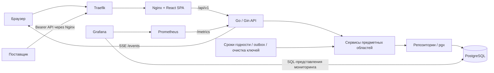

# Кладовая

Система управления ресторанным складом: приёмка поставок, учёт партий и сроков годности, рецептуры, заказы со списанием ингредиентов, стоп-лист, рекомендации закупок, горячие предложения и аналитика.

## Архитектура проекта

Проект состоит из React SPA, модульного Go backend и PostgreSQL. Сервисы предметных областей работают внутри одного процесса API; фоновые задачи запускаются в том же процессе. Внешний поставщик обращается к отдельной группе HTTP-эндпоинтов.



### Структура репозитория

| Путь | Ответственность |
|---|---|
| `frontend/src/app` | Инициализация приложения, провайдеры, маршруты, стили и MSW-моки для разработки |
| `frontend/src/pages` | Страницы склада, поставок, заказов, меню, рецептур, аналитики и администрирования |
| `frontend/src/widgets` | Составные интерфейсы: оболочка, редакторы, корзина, приёмка, списание |
| `frontend/src/features` | Пользовательские действия, авторизация, проверка ролей, формы и черновики |
| `frontend/src/entities` | Модели предметных областей, схемы Zod, RTK Query и параметры поиска |
| `frontend/src/shared` | HTTP-транспорт, SSE, UI-компоненты, токены стилей, работа с количеством и временем |
| `frontend/tests` | Браузерные сценарии Playwright и проверки с настоящим backend |
| `backend/cmd/api` | Точка сборки зависимостей, регистрация HTTP-маршрутов, запуск фоновых задач |
| `backend/cmd/migrate`, `backend/cmd/seed-users` | Применение SQL-миграций и заполнение демонстрационных данных |
| `backend/cmd/demo-events` | Генератор демонстрационных событий |
| `backend/internal/handler` | HTTP-запросы, middleware, декодирование DTO и ответы |
| `backend/internal/service` | Бизнес-правила и границы транзакций по предметным областям |
| `backend/internal/repository` | SQL-запросы, блокировки, транзакции и доступ к PostgreSQL через pgx |
| `backend/internal/model`, `backend/internal/dto` | Внутренние модели и HTTP-контракты |
| `backend/internal/fefo`, `quantity`, `validations` | Распределение по партиям, точная арифметика и валидация |
| `backend/database` | Подключение к БД, миграции, seed и проверки готовности схемы |
| `backend/docs/openapi.yaml` | OpenAPI-контракт базового API; дополнительные маршруты перечислены ниже |
| `infrastructure` | Docker Compose для local/VPS, Dockerfile, Nginx, Traefik, мониторинг |
| `supplier-demo` | Отдельный демонстрационный интерфейс внешнего поставщика |
| `scripts`, `.github/workflows` | Локальные проверки, изолированные интеграционные прогоны и CI |

Frontend использует React, TypeScript, Vite, Redux Toolkit / RTK Query, React Router, React Hook Form и Zod. Направление зависимостей: `app → pages → widgets → features → entities → shared`. Данные сервера хранятся в кэше RTK Query; состояние сессии и рабочие черновики — в Redux. Доступ к разделам задаётся общей картой ролей для навигации и маршрутов. `/dishes` открывает каталог рецептур, `/dishes/:id` — состав блюда, `/menu` — меню с добавлением блюда в заказ и управлением предложениями.

Backend использует Go, Gin, pgx и Zap. Обычный запрос проходит цепочку:

```text
middleware → handler → service → repository → PostgreSQL
```

Middleware добавляет идентификатор запроса, метрики, логирование, recovery, CORS, ограничение частоты и размера тела. Обработчик разбирает HTTP-параметры; сервис проверяет бизнес-условия и управляет транзакцией; репозиторий выполняет SQL. Ошибки приводятся к общему формату в `internal/errors`.

### Данные и бизнес-операции

| Область | Основные сущности и правила |
|---|---|
| Каталог | Категории, продукты, блюда и рецептуры; изменения с проверкой ревизии, защита связанных исторических данных |
| Склад | Партии продуктов, остатки, сроки годности и журнал движений; количества хранятся как `NUMERIC(14,3)` |
| Поставки | Поставка и её строки создают партии и приходные движения в одной транзакции |
| Заказы | Проверка общей потребности корзины; создание заказа списывает годные партии по FEFO — сначала с ближайшим сроком годности |
| История | Заказы сохраняют снимки рецептур и историю списаний; неуспешные попытки доступны отдельно |
| Списания | Ручное списание и обработка просрочки создают движения склада; автоматическая обработка включается настройкой ресторана |
| Рекомендации | Закупки, стоп-лист, прогноз дефицита и горячие предложения рассчитываются по остаткам, рецептам и истории |
| Интеграции | Токены поставщиков, соответствие внешних продуктов и входящие поставки; приёмка может быть частичной |
| Доступ | Пользователи, роли и серверные сессии; административные изменения записываются в аудит |
| События | Транзакционный outbox, опубликованные события и SSE для обновления интерфейса после изменений |

Проверка заказа не резервирует склад. При создании заказа backend повторно проверяет состояние в транзакции и использует блокировки, чтобы параллельные операции не списали одни остатки дважды. Для приёмки, заказа и ручного списания применяется идемпотентность: повтор запроса с тем же ключом возвращает сохранённый результат, другое тело с тем же ключом вызывает конфликт.

Фоновые задачи публикуют события outbox, формируют обновления при изменении доступности по времени, обрабатывают просроченные партии и очищают устаревшие ключи идемпотентности. SSE сообщает об изменениях; frontend обновляет соответствующие данные RTK Query и снимок сессии. При переподключении используется `Last-Event-ID`; если история уже недоступна, сервер отправляет `resync.required`.

## Архитектура эндпоинтов

Основной префикс — `/api/v1`. Источники регистрации маршрутов: `backend/internal/handler/router.go` и `backend/cmd/api/main.go`; политика доступа — `backend/internal/service/auth/policy.go`.

### Авторизация и формат обмена

Браузер входит через `POST /auth/login`, получает HttpOnly-cookie `flagman_session` и CSRF-токен. Изменяющие запросы требуют cookie, разрешённого `Origin` и заголовка `X-CSRF-Token`. `POST /orders/check` только читает данные и освобождён от проверки CSRF. Интеграционные маршруты используют собственную авторизацию `Authorization: Bearer <token>`.

В таблицах обозначены группы доступа:

| Группа | Роли |
|---|---|
| Все | `admin`, `manager`, `storekeeper`, `order_operator` |
| Склад | `admin`, `manager`, `storekeeper` |
| Продажи | `admin`, `manager`, `order_operator` |
| Управление | `admin`, `manager` |
| Администратор | `admin` |

Ниже пути указаны относительно `/api/v1`. Идентификаторы `:id` — UUID. Количества передаются десятичными строками с точностью до трёх знаков, даты и время — в RFC 3339. Постраничные списки обычно принимают `page`, `page_size` и возвращают `items`, `total`, `page`, `page_size`, `meta`; фильтры зависят от ресурса. Точные DTO находятся в `backend/internal/dto`, правила query-параметров — в обработчиках.

Ошибки имеют общий вид:

```json
{
  "error": {
    "code": "VALIDATION_ERROR",
    "message": "Некорректные данные",
    "details": {
      "fields": [{ "path": "quantity", "code": "invalid_value", "message": "Некорректное количество" }]
    }
  },
  "request_id": "идентификатор запроса"
}
```

Основные статусы ошибок: `400` — JSON, `401` — сессия, `403` — права или CSRF, `404` — ресурс, `409` — ревизия/остаток/идемпотентность, `413` — размер тела, `422` — валидация, `429` — частота запросов, `503` — временная недоступность. Ответ также содержит `X-Request-ID`.

### Служебные маршруты и сессия

| Метод | Путь | Доступ | Назначение |
|---|---|---|---|
| GET | `/healthcheck` | Публичный | Проверка работы HTTP-сервера |
| GET | `/ready` | Публичный | Готовность БД и схемы |
| POST | `/auth/login` | Публичный | Вход по email и паролю |
| GET | `/auth/me` | Все | Текущая сессия |
| POST | `/auth/logout` | Все | Завершение сессии |
| GET | `/events` | Все | Поток событий `text/event-stream` с фильтрацией по правам |
| GET | `/dashboard` | Все | Сводка для текущей роли |
| GET | `/settings` | Все | Настройки ресторана |
| PATCH | `/settings` | Администратор | Изменение настроек |

`GET /metrics` расположен вне `/api/v1`, защищён `METRICS_TOKEN` и используется Prometheus во внутренней сети.

### Продукты, склад и поставки

| Метод | Путь | Доступ | Назначение |
|---|---|---|---|
| GET | `/product-categories` | Все | Список категорий |
| GET | `/product-categories/:id` | Все | Категория |
| POST | `/product-categories` | Администратор | Создание категории |
| PATCH | `/product-categories/:id` | Администратор | Изменение категории |
| GET | `/products` | Все | Список продуктов |
| GET | `/products/:id` | Все | Карточка продукта |
| POST | `/products` | Администратор | Создание продукта |
| PATCH | `/products/:id` | Администратор | Изменение продукта |
| GET | `/inventory` | Все | Состояние склада |
| GET | `/products/:id/batches` | Все | Партии выбранного продукта |
| GET | `/supplies` | Склад | История поставок |
| GET | `/supplies/:id` | Склад | Подробности поставки |
| POST | `/supplies` | Склад | Приёмка и создание партий; нужен `Idempotency-Key` |
| POST | `/write-offs` | Склад | Ручное списание из партии; нужен `Idempotency-Key` |
| GET | `/stock-movements` | Склад | Журнал прихода и расхода |

`Idempotency-Key` — ненулевой UUID в единственном заголовке. Для повторного получения результата нужно сохранить исходный ключ и тело запроса.

### Блюда, рецептуры и заказы

| Метод | Путь | Доступ | Назначение |
|---|---|---|---|
| GET | `/dishes` | Продажи | Блюда, рецептуры и расчёт доступности |
| GET | `/dishes/:id` | Продажи | Состав и доступность блюда |
| POST | `/dishes` | Администратор | Создание блюда и рецептуры |
| PATCH | `/dishes/:id` | Администратор | Изменение блюда и рецептуры |
| POST | `/dishes/preview` | Администратор | Предварительный расчёт рецептуры |
| GET | `/stop-list` | Продажи | Недоступные блюда и дефицит ингредиентов |
| POST | `/orders/check` | Продажи | Проверка общей потребности корзины без списания |
| POST | `/orders` | Продажи | Создание заказа и FEFO-списание; нужен `Idempotency-Key` |
| GET | `/orders` | Продажи | История заказов |
| GET | `/orders/:id` | Продажи | Заказ, снимки и распределение списаний |
| GET | `/order-attempts` | Продажи | История попыток создания заказа |

### Рекомендации и аналитика

| Метод | Путь | Доступ | Назначение |
|---|---|---|---|
| GET | `/procurement-recommendations` | Склад | Рекомендации закупок |
| GET | `/hot-offers` | Продажи | Горячие предложения |
| GET | `/hot-offers/:id` | Управление | Настройки предложения для блюда |
| PATCH | `/hot-offers/:id` | Управление | Публикация и ручное управление предложением |
| GET | `/analytics/product-flow` | Управление | Приход, расход и потери продуктов |
| GET | `/analytics/write-offs` | Управление | Аналитика списаний |
| GET | `/analytics/ingredient-shortages` | Управление | Дефицит ингредиентов по отказам |
| GET | `/analytics/stop-list-forecast` | Управление | Прогноз попадания блюд в стоп-лист |

### Администрирование

| Метод | Путь | Доступ | Назначение |
|---|---|---|---|
| GET | `/roles` | Администратор | Список ролей |
| GET | `/users` | Администратор | Список пользователей |
| GET | `/users/:id` | Администратор | Пользователь |
| POST | `/users` | Администратор | Создание пользователя |
| PATCH | `/users/:id` | Администратор | Изменение пользователя |
| POST | `/users/:id/password` | Администратор | Смена пароля |
| GET | `/audit-log` | Администратор | Журнал административных действий |
| GET | `/integration-tokens` | Администратор | Список токенов поставщиков |
| POST | `/integration-tokens` | Администратор | Выпуск токена; открытое значение возвращается при создании |
| DELETE | `/integration-tokens/:id` | Администратор | Отзыв токена |

### Внешние поставщики

| Метод | Путь | Доступ | Назначение |
|---|---|---|---|
| GET | `/integration/products` | Bearer-токен | Чтение каталога продуктов |
| GET | `/integration/product-categories` | Bearer-токен | Чтение категорий |
| POST | `/integration/products` | Bearer-токен | Создание продукта с внешним идентификатором |
| POST | `/integration/supplies` | Bearer-токен | Отправка входящей поставки |
| GET | `/incoming-supplies` | Склад | Входящие поставки и состояние приёмки |
| POST | `/incoming-supplies/:id/accept` | Склад | Полная или частичная приёмка в складские партии |

Отправка внешней поставки не увеличивает остатки до её приёмки сотрудником. Повторы внешних продуктов и поставок контролируются по паре «токен поставщика + внешний идентификатор» и содержимому запроса. Приёмка использует `expected_revision` в JSON-теле и блокировку документа в транзакции; повтор со старой ревизией возвращает конфликт.

## Запуск

Нужны Docker с Compose и Task. Из корня проекта:

```sh
cp infrastructure/.env.example infrastructure/.env
task up
task seed
```

Если `.env` уже существует, используйте текущий файл. Для `DEPLOY_MODE=local` приложение доступно на `http://flagman.localhost`. `task up` собирает образы и применяет невыполненные миграции перед запуском backend. `task seed` добавляет демопользователей, каталог, рецептуры и партии, сохраняя существующие данные при повторном запуске.

Демопользователи: `admin@flagman.invalid`, `manager@flagman.invalid`, `storekeeper@flagman.invalid`, `operator@flagman.invalid`. Пароли задаются переменными `DEMO_ADMIN_PASSWORD`, `DEMO_MANAGER_PASSWORD`, `DEMO_STOREKEEPER_PASSWORD`, `DEMO_ORDER_OPERATOR_PASSWORD`.

Для VPS задайте `DEPLOY_MODE=vps`, `FLAGMAN_DOMAIN`, `ACME_EMAIL` и собственные пароли/токены. Домен должен указывать на сервер, порты 80/443 должны быть доступны. Compose для local и VPS самостоятельные; конфигурация VPS включает HTTPS через Traefik и Let's Encrypt, а PostgreSQL доступен только внутри Docker.

Для существующего тома PostgreSQL сохраните его учётные данные в `POSTGRES_DB`, `POSTGRES_USER`, `POSTGRES_PASS` и соответствующий `POSTGRES_URL`: переменные инициализации не меняют пароль уже созданной БД. `task down` останавливает контейнеры и сохраняет тома, `task logs` показывает логи. Grafana доступна на `127.0.0.1:3000`; локальный Prometheus — на `127.0.0.1:9090`.

Опциональный интерфейс поставщика запускается отдельно:

```sh
docker compose -f infrastructure/compose.supplier.yaml up -d --build
```

Он доступен на `http://127.0.0.1:5184` и работает с интеграционным API по выданному токену.

## Разработка и проверки

Для локальной разработки нужны Go 1.26+, Node.js/npm и golangci-lint. Зависимости frontend устанавливаются через `npm ci` в `frontend`. Для запуска Vite используйте `npm run dev`; его `/api` проксируется на `http://api.flagman.localhost`. Моки включаются переменной `VITE_ENABLE_MOCKS=true` только в режиме разработки.

```sh
bash scripts/backend-checks.sh all
bash scripts/frontend-checks.sh
bash scripts/integration-checks.sh backend
cd frontend
npm run test:acceptance
npm run test:production
```

Backend-проверки включают форматирование, lint, тесты, vet и сборку. Frontend-проверки включают ESLint, TypeScript, Vitest и production-сборку. Playwright требует установленного Chromium. Интеграционные и production-проверки поднимают отдельное Docker Compose окружение с временной БД и портами, после завершения удаляют свои ресурсы. CI использует те же скрипты.
